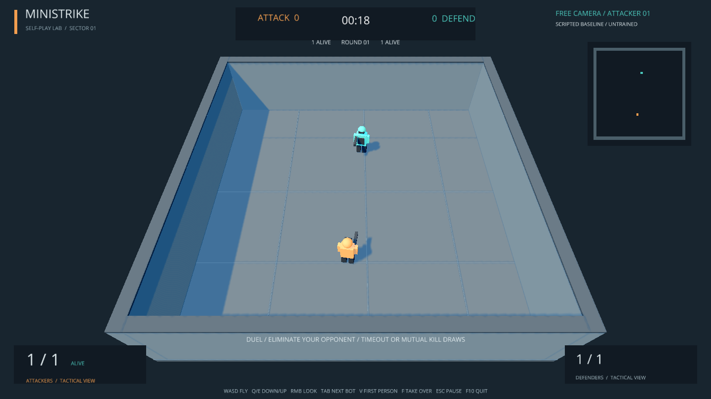
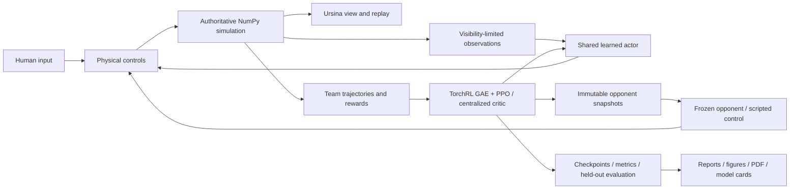

# MiniStrike

An original, local **3D first-person shooter** and a staged self-play reinforcement-learning project. Training starts now with **1v1 elimination** at fixed spawn positions in a small, symmetric, flat arena. We will progressively increase and compare complexity: randomized spawns; fixed and random spawns on a tactical map; separate free-for-all experiments with 2, 3 and 5 players; variable-player training with 2–5 players and generalization tests with 6 and 8; 3v3 team elimination; and 3v3 bomb planting/defusing, leading toward **5v5 bomb play**, more than two teams and separate transfer-learning comparisons. Simple maps precede tactical maps, and each new capability requires evidence from the preceding stage plus its own registered protocol and budget. See the [experiment roadmap](docs/experiment-roadmap.md).

Bots learn from scratch through **historical self-play with PPO**, using TorchRL's PPO loss and generalized advantage estimation (GAE), with the **MAPPO shared-actor and centralized-critic setup** for team stages. The current actor is a **tanh MLP with two hidden layers of 128 units each**, using four frames of local, visibility-limited observations and factorized categorical action heads; a separate **tanh critic with two hidden layers of 256 units each** learns from the active learner team's combined observations. In 1v1, that critic receives the single learner's observations. Recurrent memory and masked entity pooling/attention are registered later comparisons for occlusion and variable player counts. No human demonstrations, imitation learning or scripted training opponents are used. Algorithm references and the limits of these design choices are in the [shared bibliography](docs/sources.md) and [active protocol](docs/duel-protocol.md).



## Methodology and quick start

One NumPy simulation owns gameplay, collisions, visibility and outcomes; Ursina renders it. Training collects self-play experience, updates the learner and freezes snapshots as future opponents. Completing the first duel stage is sufficient for its separately recorded 12-hour budget. Before experiments, read the roadmap and active protocol linked above and the [evidence index](docs/evidence-index.md). The image above shows a scripted demonstration; trained-policy evidence is reported separately.

Install [uv](https://docs.astral.sh/uv/getting-started/installation/) and clone this repository into a writable directory. The supported and tested target is Windows with Python 3.12. `uv` creates the project-local `.venv` and obtains Python when needed.

```powershell
git clone https://github.com/BurnyCoder/3d-firstperson-shooter-reinforcement-learning-selfplay.git
cd 3d-firstperson-shooter-reinforcement-learning-selfplay
uv sync --locked
Copy-Item .env.example .env
uv run csrl play --experiment duel-fixed-v1
```

Play/watch offer **arena spectating**, **first-person bot viewing**, **first-person human play** and live takeover. Without a checkpoint the game explicitly labels its scripted demonstration. A checkpoint identifies its own compatible match; an explicit conflicting `--experiment` fails. `uv run csrl` also opens the original three-mode launcher. Select a trained checkpoint explicitly until a validation-selected Stage A recommendation is published.

```powershell
uv run csrl watch --experiment duel-fixed-v1 --first-person
# After a registered run produces this checkpoint:
uv run csrl play --experiment duel-fixed-v1 --checkpoint runs/duel-fixed-v1/confirmation/seed5101/model.pt
```

WASD moves; mouse aims; left mouse fires; R reloads; E interacts. Spectator controls let you switch between free camera and a bot's eyes, cycle living players, take over the selected bot, and return control to its policy **without resetting the round**. The on-screen guide lists the current bindings. Team 0 attacks and team 1 defends.

While spectating, **Tab** selects the next living bot, **V** changes between free camera and bot first-person, and **F** lets you become the selected bot or hand control back. You keep that player's current position, health, ammunition, and bomb state.

## Train, evaluate, and inspect

```powershell
# First publish all source/protocol/config changes; preflight checks the actual remote revision.
# This command starts the new absolute 12-hour clock; do not repeat completed calibration.
uv run csrl train --experiment duel-fixed-v1 --calibrate --run-config configs/duel-calibration.json

# Following calibration, freeze and publish the resolved pilot/confirmation configs.
# R0/R1/R2 are complete and failed selection; do not repeat them.
# Confirmation commands below remain blocked until a qualifying registered experiment exists.
uv run csrl train --experiment duel-fixed-v1 --suite --run-config configs/duel-confirmation.json

# Resume uses the same manifest, checkpoint state, identities and absolute deadline.
uv run csrl train --experiment duel-fixed-v1 --suite --run-config configs/duel-confirmation.json --resume runs/duel-fixed-v1/manifest.json

uv run csrl evaluate --experiment duel-fixed-v1 --checkpoint runs/duel-fixed-v1/confirmation/seed5101/model.pt --initial runs/duel-fixed-v1/confirmation/seed5101/initial.pt --seed-base 3000000 --output runs/duel-fixed-v1/confirmation/seed5101/validation.json
uv run pytest -q
```

At run time the application loads `.env` and published run configuration, verifies registration/source/budget, collects simultaneous actions, advances the shared simulation, computes TorchRL advantages/PPO updates, freezes opponents and saves resumable state. Calibration selects measured full-pipeline throughput with memory headroom; matched reward pilots precede three fresh confirmation seeds. Validation selects the deployment checkpoint before final-test evaluation. Failures and incomplete runs remain evidence; no significance-driven extensions are permitted. Detailed formulas and prerequisites are centralized in the active protocol.

Logs stream to the terminal and timestamped UTF-8 files in `runs/logs`. Each run retains every update in `metrics.jsonl`; evaluation retains every completed round. No LLM API or API key is needed. `.env`, logs, caches, and bulky checkpoints are not committed to source control.

**Training status:** All three matched reward pilots completed. [R0](reports/duel-fixed-v1/pilot-R0.md), [R1](reports/duel-fixed-v1/pilot-R1.md) and [R2](reports/duel-fixed-v1/pilot-R2.md) improved primary validation score by 0.012, 0.063 and 0.053 respectively, below the registered 0.10 gate. Stochastic R1/R2 improved against weak controls, but none beat the moving combat benchmark. The [completed action-mode diagnostic](reports/duel-fixed-v1/action-modes-v1.md) found only +0.017 average improvement from changing the learner alone; confirmation remains blocked. See its score and movement/health graphs alongside the [loss/reward/evaluation galleries](docs/experiment-plots.md). [Calibration](docs/amendments/2026-10-23-duel-calibration.md) selected 64 arenas with CUDA learner inference/optimization. The separate budget ends 2026-10-23 11:30:52 UTC. Deferred 5v5 evidence and deadlines remain preserved in [reports](reports/README.md).

The [duration/entropy comparison is complete](reports/duel-fixed-v1/duration-entropy-v1/README.md): fourfold experience added only 0.024 primary score; lower entropy reduced it by 0.046. Neither recipe qualifies. The next [registered diagnostic](docs/amendments/2026-10-23-egocentric-diagnostic.md) tests observer-coordinate inputs while preserving PPO, network size, reward and controls, preceded by a real save/resume check. The [sourced shooter-RL design review](docs/shooter-rl-design-review.md) compares networks, algorithms, inputs and outputs from Doom, Quake and Unity DodgeBall and records separately testable alternatives.

**Saved graphs:** [reward components](reports/duel-fixed-v1/losses/training/reward-pilots-rewards.png), [loss comparison](reports/duel-fixed-v1/losses/reward-pilots.png), [combat, behavior and optimizer diagnostics](reports/duel-fixed-v1/losses/training/README.md), [primary validation scores](reports/duel-fixed-v1/losses/validation-deterministic.png), [spawn-end and win/draw/loss breakdown](reports/duel-fixed-v1/losses/validation-deterministic-breakdown.png) and [secondary stochastic scores](reports/duel-fixed-v1/losses/validation-stochastic.png). [Every Stage A run](reports/duel-fixed-v1/losses/README.md) has PNG/SVG loss exports; reward/activity views use the gameplay telemetry where recorded. [Plotting instructions](docs/experiment-plots.md) explain units, provenance, reproduction and historical galleries. Reports automatically save these graphs.

Public checkpoints and model cards are grouped in the [MiniStrike Hugging Face collection](https://huggingface.co/collections/BurnyCoder/ministrike-self-play-tactical-bots-6ada65970d163e293d48f3ad). Each card identifies its training budget and measured evaluation; short verification models are explicitly labeled. To download a published model, install the locked environment and use `uv run hf download BurnyCoder/ministrike-selfplay-cpu --local-dir artifacts/models/selfplay-cpu`, then select `artifacts/models/selfplay-cpu/model.pt` in the launcher. Publication instructions are in [the workflow documentation](docs/publication.md).

## Features and technologies

- A small symmetric fixed-spawn duel arena plus the original tactical 5v5 bomb map, finite rifle ammunition/reloads and explicit simultaneous-shot/round rules.
- Human first-person play, arena spectating, first-person bot spectating, and live bot takeover/hand-back.
- Visibility-limited four-frame observations, simultaneous shots, fixed timestep, partial arena resets, seeded state, replay, and checkpoint resume.
- TorchRL PPO with frozen historical opponents, masked dead-player actor losses and a separate team critic. Scripted controls are evaluation-only in the staged protocol; old fixed-opponent training remains historical evidence.
- Python 3.12, NumPy, Ursina/Panda3D, PyTorch, TorchRL/TensorDict, SciPy, Matplotlib, ReportLab, pytest, and uv. `uv.lock` records exact versions.

Windows uses the official PyTorch CUDA13.0 wheel index; CPU execution remains available. The GPU path was tested with an RTX5070 Laptop GPU and driver591.74. Stage A takes execution placement from its published run configuration and bounded calibration. [uv PyTorch integration](https://docs.astral.sh/uv/guides/integration/pytorch/)

The deferred suite used six independent CUDA learners with16 arenas each and one CPU thread per worker, selected through [ten documented hardware probes](reports/performance/summary.md). Stage A reuses those findings as a starting point, then makes one bounded comparison for its smaller workload. The goal is fastest complete collection/update throughput with memory headroom, not an arbitrary GPU-utilization percentage.



The core release intentionally uses flat-ground movement and box geometry. There is no buying, grenade system, crouching, jumping, online networking, or guarantee of skill against human players. Friendly fire is off; teammates block shots but player movement does not collide. Detailed rules, observation/action layout, reward definitions, and source references are in [technical documentation](docs/architecture.md).
