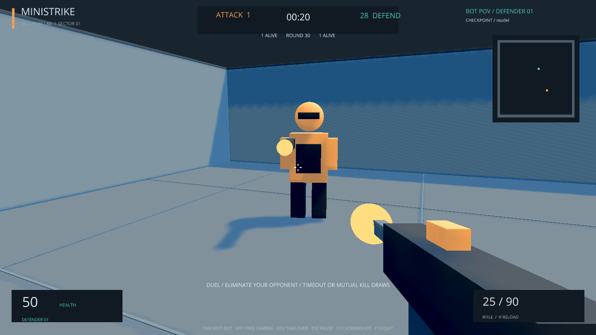
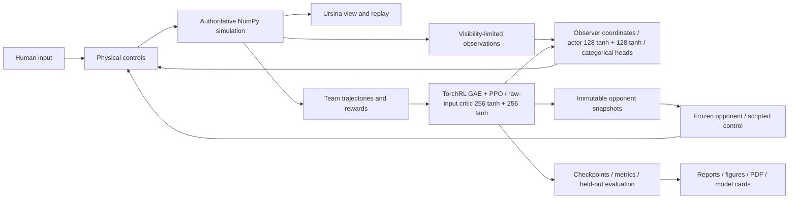

# MiniStrike

An original, local **3D first-person shooter** and a staged self-play reinforcement-learning project. Training starts with **1v1 elimination** at fixed spawn positions in a small, symmetric, flat arena. We will progressively increase and compare complexity: randomized spawns; fixed and random spawns on a tactical map; separate free-for-all experiments with 2, 3 and 5 players; variable-player training with 2–5 players and generalization tests with 6 and 8; 3v3 team elimination; and 3v3 bomb planting/defusing, leading toward **5v5 bomb play**, more than two teams and separate transfer-learning comparisons. Simple maps precede tactical maps, and each new capability requires evidence from the preceding stage plus its own registered protocol and budget. See the [experiment roadmap](docs/experiment-roadmap.md).

Bots learn from scratch through **historical self-play with PPO**, using TorchRL's PPO loss and generalized advantage estimation (GAE), with the **MAPPO shared-actor and centralized-critic setup** for team stages. The current actor is a **tanh MLP with two hidden layers of 128 units each**, using four frames of local, visibility-limited observations and factorized categorical action heads; a separate **tanh critic with two hidden layers of 256 units each** learns from the active learner team's combined observations. In 1v1, that critic receives the single learner's observations. Recurrent memory and masked entity pooling/attention are registered later comparisons for occlusion and variable player counts. No human demonstrations, imitation learning or scripted training opponents are used. Algorithm references and the limits of these design choices are in the [shared bibliography](docs/sources.md) and [active protocol](docs/duel-protocol.md).



**Bot gameplay:** [watch the 24-second first-person video](docs/media/duel-gameplay.mp4). Both bots use the trained seed 5101 checkpoint in fixed-spawn 1v1 self-play. This is an experimental model; the clip illustrates gameplay, not generalization or benchmark success. [Recording details](docs/media/README.md).

## Methodology and quick start

One NumPy simulation owns gameplay, collisions, visibility and outcomes; Ursina renders it. Training collects self-play experience, updates the learner and freezes snapshots as future opponents. Stage A has completed its registered training and evaluation within its separately recorded 12-hour allowance. Before any new experiment, read the roadmap, active protocol and [evidence index](docs/evidence-index.md). The image above shows confirmation seed 5101, selected by validation before testing; its actor rotates visible relative positions into the observer's coordinate frame.

**Measured result:** three independent models improved primary final-test round score by **0.415** on average (model-level 95% t interval **0.412–0.419**). Their median moving-script score was **0.25**, below the required **0.55**, so the models are **experimental**. Fixed-spawn learning does not establish new-map, random-spawn or human-opponent skill. [Results and limitations](reports/duel-fixed-v1/confirmation/README.md) · [all experiments](reports/summary.md) · [paper](reports/duel-fixed-v1/paper.pdf).

Install [uv](https://docs.astral.sh/uv/getting-started/installation/) and clone this repository into a writable directory. The supported and tested target is Windows with Python 3.12. `uv` creates the project-local `.venv` and obtains Python when needed.

```powershell
git clone https://github.com/BurnyCoder/3d-firstperson-shooter-reinforcement-learning-selfplay.git
cd 3d-firstperson-shooter-reinforcement-learning-selfplay
uv sync --locked
Copy-Item .env.example .env
uv run csrl play --experiment duel-fixed-v1
```

Play/watch offer **arena spectating**, **first-person bot viewing**, **first-person human play** and live takeover. Without a checkpoint the game explicitly labels its scripted demonstration. A checkpoint identifies its own compatible match; an explicit conflicting `--experiment` fails. `uv run csrl` also opens the three-mode launcher. Download the validation-selected experimental checkpoint to watch or play against it:

```powershell
uv run hf download BurnyCoder/ministrike-duel-fixed-v1-seed5101 --local-dir artifacts/models/duel-seed5101
uv run csrl watch --experiment duel-fixed-v1 --checkpoint artifacts/models/duel-seed5101/model.pt
uv run csrl watch --experiment duel-fixed-v1 --checkpoint artifacts/models/duel-seed5101/model.pt --first-person
uv run csrl play --experiment duel-fixed-v1 --checkpoint artifacts/models/duel-seed5101/model.pt
```

WASD moves; mouse aims; left mouse fires; R reloads; E interacts. Spectator controls let you switch between free camera and a bot's eyes, cycle living players, take over the selected bot, and return control to its policy **without resetting the round**. The on-screen guide lists the current bindings. Team 0 attacks and team 1 defends.

While spectating, **Tab** selects the next living bot, **V/F1** changes between free camera and bot first-person, and **F/F2** lets you become the selected bot or hand control back. You keep that player's current position, health, ammunition, and bomb state. The function keys also support remote input tools that do not send letter scan codes.

## Train, evaluate, and inspect

```powershell
uv run csrl evaluate --experiment duel-fixed-v1 --checkpoint artifacts/models/duel-seed5101/model.pt --initial artifacts/models/duel-seed5101/initial.pt --seed-base 3000000 --output runs/local-inspection/validation.json
# Rebuild figures/analysis from committed records without training or new matches:
uv run python scripts/report_confirmation.py --input reports/duel-fixed-v1/confirmation/data --output runs/reproduced-confirmation
uv run pytest -q
```

Training and resume entry points remain `csrl train --experiment duel-fixed-v1 --suite --run-config CONFIG` and the same command with `--resume MANIFEST`. The completed Stage A registrations cannot be rerun as new experiments. A new replication needs its own published registration, output identity, resolved config and authorized budget; follow the [training/replication procedure](docs/duel-protocol.md#replication-after-completion). Existing manifests retain their original deadlines on resume.

At run time the application loads `.env` and published run configuration, verifies registration/source/budget, collects simultaneous actions, advances the shared simulation, computes TorchRL advantages/PPO updates, freezes opponents and saves resumable state. Calibration selects measured full-pipeline throughput with memory headroom; matched reward pilots precede three fresh confirmation seeds. Validation selects the deployment checkpoint before final-test evaluation. Failures and incomplete runs remain evidence; no significance-driven extensions are permitted. Detailed formulas and prerequisites are centralized in the active protocol.

Logs stream to the terminal and timestamped UTF-8 files in `runs/logs`. Each run retains every update in `metrics.jsonl`; evaluation retains every completed round. No LLM API or API key is needed. `.env`, local logs, caches, and bulky checkpoints are ignored by source control; explicitly reviewed experiment logs are published with the evidence, and model binaries live on Hugging Face.

**Completed training:** fresh seeds 5101, 5102 and 5103 each reached **5,464,064 arena steps / 667 updates**. All 24 initial/final validation/test endpoints completed. [Calibration](docs/amendments/2026-10-23-duel-calibration.md) selected one CUDA learner with 64 arenas and CPU frozen opponents under the registered memory-headroom constraint. The original 09:30 UTC training and 11:30:52 UTC overall boundaries on 23 October 2026 were retained. No later stage is started automatically.

Earlier [R0](reports/duel-fixed-v1/pilot-R0.md), [R1](reports/duel-fixed-v1/pilot-R1.md), [R2](reports/duel-fixed-v1/pilot-R2.md), [action-mode](reports/duel-fixed-v1/action-modes-v1.md) and [duration/entropy](reports/duel-fixed-v1/duration-entropy-v1/README.md) comparisons failed their registered gates and remain fully reported. The input intervention retained PPO, model size, reward and controls; its [real save/resume prerequisite](reports/duel-fixed-v1/egocentric-v1/resume.md) matched exactly over two production updates. The [sourced shooter-RL design review](docs/shooter-rl-design-review.md) compares networks, algorithms, inputs and outputs from Doom, Quake and Unity DodgeBall. Deferred5v5 evidence and deadlines remain preserved in [reports](reports/README.md). No result here establishes generalization beyond the fixed duel arena.

**Saved graphs:** [confirmation losses](reports/duel-fixed-v1/confirmation/curves/a-confirm.png), [rewards](reports/duel-fixed-v1/confirmation/curves/training/a-confirm-rewards.png), [combat/behavior/optimizer measures](reports/duel-fixed-v1/confirmation/curves/training/README.md), [test scores](reports/duel-fixed-v1/confirmation/test-deterministic.png), [side and win/draw/loss breakdown](reports/duel-fixed-v1/confirmation/test-deterministic-breakdown.png), and [model versus match uncertainty](reports/duel-fixed-v1/confirmation/uncertainty.png). The [gallery guide](docs/experiment-plots.md) links 135 PNG/SVG chart pairs, including earlier negative experiments, with raw inputs, hashes and reproducible commands. Rewards are interval means per arena step, not episode returns.

All model outcomes and cards are grouped in the [MiniStrike Hugging Face collection](https://huggingface.co/collections/BurnyCoder/ministrike-staged-shooter-self-play-6ada65970d163e293d48f3ad). [Public file verification](reports/publication/README.md) covers the three confirmation, three pilot, three diagnostic and six deferred pairs. Diagnostic and smoke models are not deployment recommendations. [Native screenshots and nine exact replay checks](reports/duel-fixed-v1/confirmation/native/README.md) verify the selected model's view/takeover workflow and document the remaining physical-input testing limitation.

## Features and technologies

- A small symmetric fixed-spawn duel arena plus the original tactical 5v5 bomb map, finite rifle ammunition/reloads and explicit simultaneous-shot/round rules.
- Human first-person play, arena spectating, first-person bot spectating, and live bot takeover/hand-back.
- Visibility-limited four-frame observations, simultaneous shots, fixed timestep, partial arena resets, seeded state, replay, and checkpoint resume.
- TorchRL PPO with frozen historical opponents, masked dead-player actor losses and a separate team critic. Scripted controls are evaluation-only in the staged protocol; old fixed-opponent training remains historical evidence.
- Python 3.12, NumPy, Ursina/Panda3D, PyTorch, TorchRL/TensorDict, SciPy, Matplotlib, ReportLab, pytest, and uv. `uv.lock` records exact versions.

Windows uses the official PyTorch CUDA13.0 wheel index; CPU execution remains available. The GPU path was tested with an RTX5070 Laptop GPU and driver591.74. Stage A takes execution placement from its published run configuration and bounded calibration. [uv PyTorch integration](https://docs.astral.sh/uv/guides/integration/pytorch/)

The deferred suite used six independent CUDA learners with16 arenas each and one CPU thread per worker, selected through [ten documented hardware probes](reports/performance/summary.md). Stage A reused those findings as a starting point, then made one bounded comparison for its smaller workload. The goal is fastest complete collection/update throughput with memory headroom, not an arbitrary GPU-utilization percentage.



The core release intentionally uses flat-ground movement and box geometry. There is no buying, grenade system, crouching, jumping, online networking, or guarantee of skill against human players. Friendly fire is off; teammates block shots but player movement does not collide. Detailed rules, observation/action layout, reward definitions, and source references are in [technical documentation](docs/architecture.md).
