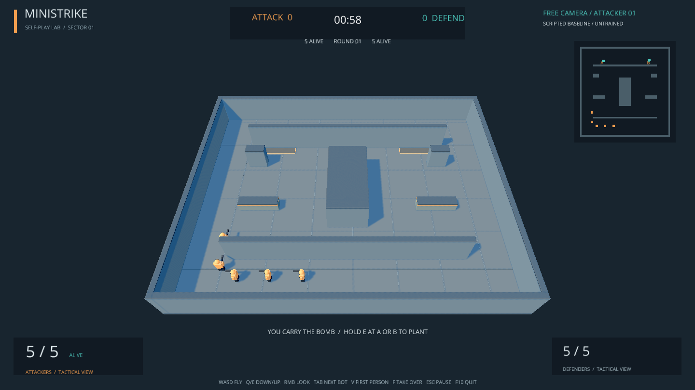
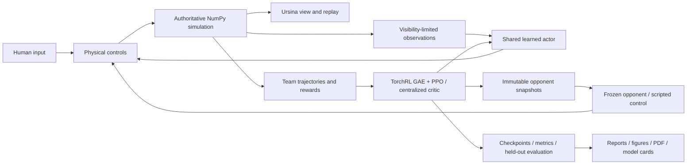

# MiniStrike

An original, local **3D first-person shooter** and a staged self-play reinforcement-learning project. The current task is fixed-spawn **1v1 elimination** in a small flat arena; the original 5v5 bomb game remains available as a deferred advanced experiment.



## Methodology and quick start

One NumPy simulation owns gameplay, collisions, visibility and outcomes; Ursina renders it. Randomly initialized bots train exclusively against frozen self-play snapshots using TorchRL PPO/GAE, local four-frame observations and a separate team value network. No human data, imitation learning or scripted training opponents are used in the new stages. Progression is fixed-spawn duel → random spawns → tactical maps → free-for-all → teams → bomb objectives. Completing the first duel stage is sufficient for its separately recorded 12-hour budget. Read the [complete registered roadmap](docs/experiment-roadmap.md), [active protocol](docs/duel-protocol.md), [sources](docs/sources.md) and [evidence index](docs/evidence-index.md) before experiments. The image above depicts the original 5v5 map, not measured duel learning.

Install [uv](https://docs.astral.sh/uv/getting-started/installation/) and clone this repository into a writable directory. The supported and tested target is Windows with Python 3.12. `uv` creates the project-local `.venv` and obtains Python when needed.

```powershell
git clone https://github.com/BurnyCoder/counter-strike-reinforcement-learning-selfplay.git
cd counter-strike-reinforcement-learning-selfplay
uv sync --locked
Copy-Item .env.example .env
uv run csrl play --experiment duel-fixed-v1
```

Play/watch offer **arena spectating**, **first-person bot viewing**, **first-person human play** and live takeover. Without a checkpoint the game explicitly labels its scripted demonstration. A checkpoint identifies its own compatible match; an explicit conflicting `--experiment` fails. `uv run csrl` also opens the original three-mode launcher. Select a trained checkpoint explicitly until a validation-selected Stage A recommendation is published.

```powershell
uv run csrl watch --experiment duel-fixed-v1 --first-person
# After a registered run produces this checkpoint:
uv run csrl play --experiment duel-fixed-v1 --checkpoint runs/duel-fixed-v1/confirmation/seed5101/model.pt
```

WASD moves; mouse aims; left mouse fires; R reloads; E interacts. Spectator controls let you switch between free camera and a bot's eyes, cycle living players, take over the selected bot, and return control to its policy **without resetting the round**. The on-screen guide lists the current bindings. Team 0 attacks and team 1 defends.

While spectating, **Tab** selects the next living bot, **V** changes between free camera and bot first-person, and **F** lets you become the selected bot or hand control back. You keep that player's current position, health, ammunition, and bomb state.

## Train, evaluate, and inspect

```powershell
# First publish all source/protocol/config changes; preflight checks the actual remote revision.
# This command starts the new absolute 12-hour clock; do not repeat completed calibration.
uv run csrl train --experiment duel-fixed-v1 --calibrate --run-config configs/duel-calibration.json

# Following calibration, freeze and publish the resolved pilot/confirmation configs.
# These dependent files intentionally do not exist until their prerequisites are satisfied.
uv run csrl train --experiment duel-fixed-v1 --run-config configs/duel-pilot-R0.json
uv run csrl train --experiment duel-fixed-v1 --suite --run-config configs/duel-confirmation.json

# Resume uses the same manifest, checkpoint state, identities and absolute deadline.
uv run csrl train --experiment duel-fixed-v1 --suite --run-config configs/duel-confirmation.json --resume runs/duel-fixed-v1/manifest.json

uv run csrl evaluate --experiment duel-fixed-v1 --checkpoint runs/duel-fixed-v1/confirmation/seed5101/model.pt --initial runs/duel-fixed-v1/confirmation/seed5101/initial.pt --seed-base 3000000 --output runs/duel-fixed-v1/confirmation/seed5101/validation.json
uv run pytest -q
```

At run time the application loads `.env` and published run configuration, verifies registration/source/budget, collects simultaneous actions, advances the shared simulation, computes TorchRL advantages/PPO updates, freezes opponents and saves resumable state. Calibration selects measured full-pipeline throughput with memory headroom; matched reward pilots precede three fresh confirmation seeds. Validation selects the deployment checkpoint before final-test evaluation. Failures and incomplete runs remain evidence; no significance-driven extensions are permitted. Detailed formulas and prerequisites are centralized in the active protocol.

Logs stream to the terminal and timestamped UTF-8 files in `runs/logs`. Each run retains every update in `metrics.jsonl`; evaluation retains every completed round. No LLM API or API key is needed. `.env`, logs, caches, and bulky checkpoints are not committed to source control.

**Training status:** Stage A implementation/registration is in progress; no new Stage A learning result is claimed here. The original 5v5 suite is deferred, with checkpoints, zero-win controls, diagnostics and interruptions preserved. Its deadlines are not extended. Measured findings belong in [reports](reports/README.md); a running optimizer or decreasing loss does not establish useful combat learning.

Public checkpoints and model cards are grouped in the [MiniStrike Hugging Face collection](https://huggingface.co/collections/BurnyCoder/ministrike-self-play-tactical-bots-6ada65970d163e293d48f3ad). Each card identifies its training budget and measured evaluation; short verification models are explicitly labeled. To download a published model, install the locked environment and use `uv run hf download BurnyCoder/ministrike-selfplay-cpu --local-dir artifacts/models/selfplay-cpu`, then select `artifacts/models/selfplay-cpu/model.pt` in the launcher. Publication instructions are in [the workflow documentation](docs/publication.md).

## Features and technologies

- A small symmetric fixed-spawn duel arena plus the original tactical 5v5 bomb map, finite rifle ammunition/reloads and explicit simultaneous-shot/round rules.
- Human first-person play, arena spectating, first-person bot spectating, and live bot takeover/hand-back.
- Visibility-limited four-frame observations, simultaneous shots, fixed timestep, partial arena resets, seeded state, replay, and checkpoint resume.
- TorchRL PPO with frozen historical opponents, masked dead-player actor losses and a separate team critic. Scripted controls are evaluation-only in the staged protocol; old fixed-opponent training remains historical evidence.
- Python 3.12, NumPy, Ursina/Panda3D, PyTorch, TorchRL/TensorDict, SciPy, Matplotlib, ReportLab, pytest, and uv. `uv.lock` records exact versions.

Windows uses the official PyTorch CUDA13.0 wheel index; CPU execution remains available. The GPU path was tested with an RTX5070 Laptop GPU and driver591.74. `--device auto` benchmarks optimizer devices for the suite rather than assuming GPU training is faster for these small networks. [uv PyTorch integration](https://docs.astral.sh/uv/guides/integration/pytorch/)

The deferred suite used six independent CUDA learners with16 arenas each and one CPU thread per worker, selected through [ten documented hardware probes](reports/performance/summary.md). Stage A reuses those findings as a starting point, then makes one bounded comparison for its smaller workload. The goal is fastest complete collection/update throughput with memory headroom, not an arbitrary GPU-utilization percentage.



The core release intentionally uses flat-ground movement and box geometry. There is no buying, grenade system, crouching, jumping, online networking, or guarantee of skill against human players. Friendly fire is off; teammates block shots but player movement does not collide. Detailed rules, observation/action layout, reward definitions, and source references are in [technical documentation](docs/architecture.md).
