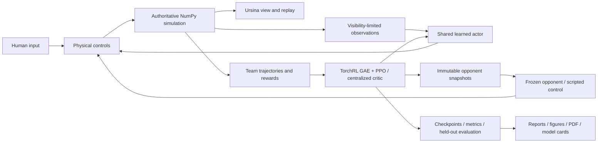

# MiniStrike

An original, local **3D first-person 5v5 tactical shooter** and a reproducible self-play reinforcement-learning experiment. Two teams fight around two bomb sites. Bots learn raw movement, aiming, firing, reloading, and interaction from visibility-limited game observations.


## Methodology and quick start

One NumPy simulation owns gameplay, collisions, visibility, and round outcomes. Ursina draws that state. TorchRL trains a shared decentralized actor with a centralized training-only critic (MAPPO). Historical self-play uses frozen earlier opponents; a separate fixed-opponent condition measures whether self-play helps. See the [pre-specified experiment protocol](docs/protocol.md).

Install [uv](https://docs.astral.sh/uv/getting-started/installation/) and clone this repository into a writable directory. The supported and tested target is Windows with Python 3.12. `uv` creates the project-local `.venv` and obtains Python when needed.

```powershell
git clone https://github.com/BurnyCoder/counter-strike-reinforcement-learning-selfplay.git
cd counter-strike-reinforcement-learning-selfplay
uv sync --locked
Copy-Item .env.example .env
uv run csrl
```

The launcher offers **Watch arena**, **Watch bot first-person**, and **Play first-person**. Before a trained checkpoint is available, it explicitly labels the scripted baseline. After the suite finishes, both watch and play use the same pre-selected trained checkpoint. You can browse to a different checkpoint.

```powershell
uv run csrl watch --first-person --checkpoint runs/suite/selfplay_seed111/model.pt
uv run csrl play --team 0 --checkpoint runs/suite/selfplay_seed111/model.pt
```

WASD moves; mouse aims; left mouse fires; R reloads; E interacts. Spectator controls let you switch between free camera and a bot's eyes, cycle living players, take over the selected bot, and return control to its policy **without resetting the round**. The on-screen guide lists the current bindings. Team 0 attacks and team 1 defends.

While spectating, **Tab** selects the next living bot, **V** changes between free camera and bot first-person, and **F** lets you become the selected bot or hand control back. You keep that player's current position, health, ammunition, and bomb state.

## Train, evaluate, and inspect

```powershell
# Short real self-play run; creates initial.pt, model.pt, configuration and metrics.
uv run csrl train --output runs/example --frames 65536 --max-hours 0.1

# Six independent runs, with calibration and before/after evaluation; hard upper allowance12h.
uv run csrl train --suite --output runs/suite --device auto --max-hours 12

# Resume the same suite and its original deadline.
uv run csrl train --suite --resume runs/suite/suite.json

# Reload one interrupted training checkpoint without changing its original run budget.
uv run csrl train --output runs/example --resume runs/example/model.pt

# An independent evaluation (never updates weights).
uv run csrl evaluate --checkpoint runs/example/model.pt --output runs/example/evaluation.json --pairs 128
uv run csrl report --input runs/suite --output reports
uv run pytest -q
```

At run time the application loads local configuration, initializes logging, collects simultaneous team actions, advances the shared simulation, computes TorchRL advantages/PPO updates, freezes opponent snapshots, and writes resumable checkpoints. The suite calibrates complete update throughput, freezes an equal arena-transition budget, trains three seeds per condition, and evaluates both initial and final checkpoints on untouched, side-swapped test worlds. It stops at its budget; it never trains until a favorable significance result appears.

Logs stream to the terminal and timestamped UTF-8 files in `runs/logs`. Each run retains every update in `metrics.jsonl`; evaluation retains every completed round. No LLM API or API key is needed. `.env`, logs, caches, and bulky checkpoints are not committed to source control.

**Training status:** the repository implements the experiment; measured training results belong in [reports](reports/README.md). An initial implementation, scripted opponent, or short smoke run is not evidence of learned tactical competence. Three seeds per condition are a pilot unless the uncertainty supports a stronger claim.

Public checkpoints and model cards are grouped in the [MiniStrike Hugging Face collection](https://huggingface.co/collections/BurnyCoder/ministrike-self-play-tactical-bots-6ada65970d163e293d48f3ad). Each card identifies its training budget and measured evaluation; short verification models are explicitly labeled. To download a published model, install the locked environment and use `uv run hf download BurnyCoder/ministrike-selfplay-cpu --local-dir artifacts/models/selfplay-cpu`, then select `artifacts/models/selfplay-cpu/model.pt` in the launcher. Publication instructions are in [the workflow documentation](docs/publication.md).

## Features and technologies

- One original 3D map, cover, two bomb sites, full 5v5 rounds, rifle ammunition/reloads, carrying/dropping/planting/defusing, and explicit terminal rules.
- Human first-person play, arena spectating, first-person bot spectating, and live bot takeover/hand-back.
- Visibility-limited four-frame observations, simultaneous shots, fixed timestep, partial arena resets, seeded state, replay, and checkpoint resume.
- MAPPO with frozen historical opponents, masked dead-player actor losses, centralized critic, and an observation-only scripted control condition.
- Python 3.12, NumPy, Ursina/Panda3D, PyTorch, TorchRL/TensorDict, SciPy, Matplotlib, ReportLab, pytest, and uv. `uv.lock` records exact versions.

Windows uses the official PyTorch CUDA13.0 wheel index; CPU execution remains available. The GPU path was tested with an RTX5070 Laptop GPU and driver591.74. `--device auto` benchmarks optimizer devices for the suite rather than assuming GPU training is faster for these small networks. [uv PyTorch integration](https://docs.astral.sh/uv/guides/integration/pytorch/)

The active primary suite has a recorded execution amendment selecting six independent CUDA learners with 16 arenas each (96 arenas total) and one CPU thread per worker. Short probes measured 3,272 aggregate arena steps/s versus 737 for the original single learner; longer-run performance and playing quality require separate evidence. A follow-up comparison found two CPU threads per worker slower than one. Per-model learning settings, the frozen step budget, and the original overall deadline are preserved. See [all hardware probes and their limitations](reports/performance/summary.md).



The core release intentionally uses flat-ground movement and box geometry. There is no buying, grenade system, crouching, jumping, online networking, or guarantee of skill against human players. Friendly fire is off; teammates block shots but player movement does not collide. Detailed rules, observation/action layout, reward definitions, and source references are in [technical documentation](docs/architecture.md).
