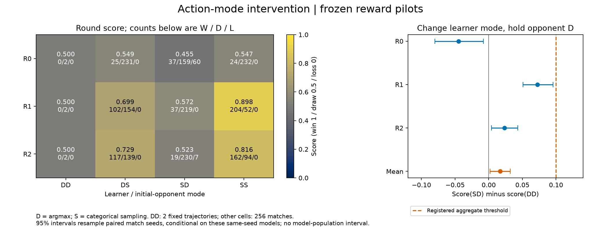

# A-DIAG-ACTION-MODES-1 — action selection does not explain the full learning failure

**Completed, exploratory, no optimizer updates.** The registered learner-only mode effect was **+0.0169271**, with a conditional paired-match 95% bootstrap interval **[+0.0019531, +0.0319010]**. This fails the prospectively specified +0.10 diagnostic threshold. The original R0/R1/R2 pilot failures and blocked confirmation decision remain unchanged. [Registered hypothesis/method](../../docs/amendments/2026-10-23-action-mode-diagnostic.md), [raw analysis](data/action-modes-v1/analysis.json).

## Method and execution

Previous deterministic versus stochastic evaluation changed both the learner and its initial-policy opponent. This intervention independently set learner and opponent to D (per-head argmax) or S (categorical sampling), keeping weights, rules, legal observations, layout and validation seeds unchanged. Both spawn ends were evaluated. No optimizer, demonstration or final-test access occurred. The six checkpoint hashes, task/model/reward provenance, 900-second bound and analysis were published in the [configuration](../../configs/duel-action-modes-v1.json) and registration before execution.

Execution used source `461e486c0f60f78e15041ed6d3f93aa7ed4c1721`, from **01:32:13.738270 to 01:34:58.399169 UTC on 2026-10-23**, consuming **164.660899 seconds** of the unchanged Stage A clock. All 12 cells completed: 2,310 trajectories, including 774 deliberately repeated DD/SS controls. **Every field in those 774 raw outcome/counter records exactly matches its previous pilot evaluation.** These repeats are not additional independent evidence. Two transient Windows sharing-denial warnings recovered on their first retry; logs are retained. [Receipt](data/action-modes-v1/receipt.json), [logs](data/action-modes-v1/logs/), [hashes and audit](action-mode-verification.json).

## All outcomes

The first mode letter is the learner; the second is its frozen initial opponent. Scores equally weight spawn ends. DD has only two unique fixed trajectories; each other cell has 128 paired seeds on both ends. Wins/draws/losses score 1/0.5/0. [Raw cells](data/action-modes-v1/), [both side scores and derived counters](action-mode-verification.json).

| Reward | Modes | Score | Wins / draws / losses | Elimination fraction |
|---|---|---:|---:|---:|
|R0|DD|0.500000|0 / 2 / 0|0.000000|
|R0|DS|0.548828|25 / 231 / 0|0.097656|
|R0|SD|0.455078|37 / 159 / 60|0.382812|
|R0|SS|0.546875|24 / 232 / 0|0.093750|
|R1|DD|0.500000|0 / 2 / 0|0.000000|
|R1|DS|0.699219|102 / 154 / 0|0.398438|
|R1|SD|0.572266|37 / 219 / 0|0.144531|
|R1|SS|0.898438|204 / 52 / 0|0.796875|
|R2|DD|0.500000|0 / 2 / 0|0.000000|
|R2|DS|0.728516|117 / 139 / 0|0.457031|
|R2|SD|0.523438|19 / 230 / 7|0.101563|
|R2|SS|0.816406|162 / 94 / 0|0.632813|

| Reward | Learner effect, opponent D: SD−DD | Learner effect, opponent S: SS−DS | Opponent effect, learner D: DS−DD | Interaction |
|---|---:|---:|---:|---:|
|R0|−0.044922|−0.001953|+0.048828|+0.042969|
|R1|+0.072266|+0.199219|+0.199219|+0.126953|
|R2|+0.023438|+0.087891|+0.228516|+0.064453|

All secondary conditional intervals are retained in [analysis.json](data/action-modes-v1/analysis.json); they are descriptive, without multiplicity-adjusted significance claims. For R1, changing only the opponent contributes +0.199219, changing only the learner +0.072266, and their interaction +0.126953: together the observed SS−DD difference is +0.398438. This establishes dependence on both modes for these fixed models, not a learner-only fix. Changing a controller can also change its opponent's subsequent observations and actions.

## Fixed trace evidence

All 24 prospectively selected seed-3,000,000 traces are retained. Position/health figures: [R0 end 0](action-modes-v1/trace-R0-end0.png), [R0 end 1](action-modes-v1/trace-R0-end1.png), [R1 end 0](action-modes-v1/trace-R1-end0.png), [R1 end 1](action-modes-v1/trace-R1-end1.png), [R2 end 0](action-modes-v1/trace-R2-end0.png), [R2 end 1](action-modes-v1/trace-R2-end1.png). Each has an SVG. Cell JSON contains pre-action state, decoded actions, legal visibility, visible-target angle and actual shot/damage events.

Every DD match times out. In the learner-end-0 DD traces, all three learners request firing throughout, never request reload, and have an empty magazine on **75.5%** of 400 pre-action ticks. Movement paths reach perimeter walls and frequently stop changing position. R1's DD results average 37.5 damage and 38.5 shots per round, with pooled hit accuracy 3/77 = 0.0389610. These are observed behavioral shortcomings, not proof of a simulator or optimizer defect. [Trace summaries and pooled counters](action-mode-verification.json).

Deterministic traces are fixed trajectories; stochastic traces show only the registered first seed. They do not replace all-match aggregates. Pre-action health omits damage after the last plotted sample; outcome labels and raw events provide the terminal result. Visibility or a small angle alone does not prove a valid hit.

## Interpretation and limitations

There is measured improvement against some weak opponents in the earlier pilots, but no accepted deployment policy. This diagnostic weakens the learner-mode explanation for the overall failure. It does not explain zero wins against the separate moving scripted benchmark, prove convergence, or establish that longer training will work. The read-only pipeline inspection and 90 existing passing correctness tests found no new established PPO/GAE fault; passing tests do not prove absence of faults. Both Windows CI checks passed at the execution revision.

Training duration and exploration strength remain plausible next questions. Sample Factory's Doom self-play uses an eight-policy population, recurrent visual policies and much larger experience budgets; PBT varies entropy and reward settings. Its reported 2.5 billion environment frames per policy are **not a sample-complexity estimate for this smaller state-input task**. This motivates controlled variables, not a claim that our elapsed time or losses are normal. [Primary paper, sections 3.5 and 4.3](https://vladlen.info/papers/sample-factory.pdf), [official PBT documentation](https://www.samplefactory.dev/07-advanced-topics/pbt/).

All three reward variants share training seed 5201. Intervals condition on these weights and resample complete match-seed blocks with both ends and cross-variant coupling intact. They do not estimate uncertainty across independently retrained models. No final-test access, favorable-seed replacement or significance-driven extension occurred. [Registered analysis](../../docs/amendments/2026-10-23-action-mode-diagnostic.md), [evaluation uncertainty reference](https://arxiv.org/abs/2108.13264).

Reproduce without checkpoints or gameplay: `uv run python scripts/report_action_modes.py --input reports/duel-fixed-v1/data/action-modes-v1 --output runs/reproduced-action-modes`. The reporter checks original pilot endpoints, reproduces analysis, copies exact raw bytes and exports seven PNG/SVG pairs. [Implementation](../../src/ministrike/experiments/mode_reporting.py). Thresholds and plot choices are engineering decisions; no external source implementation was copied.
