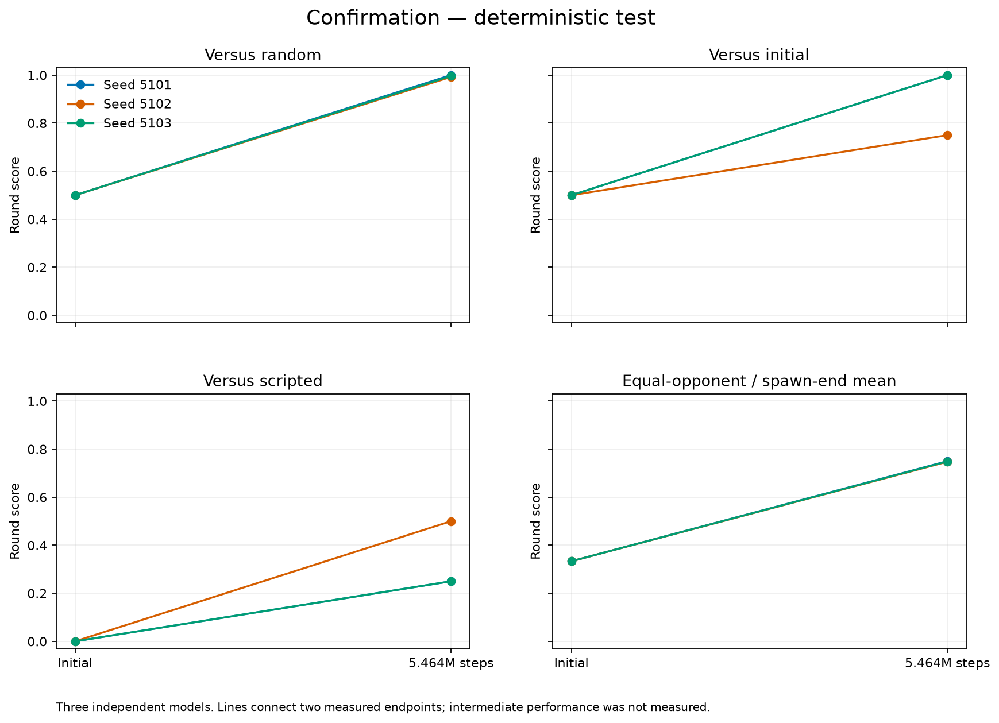
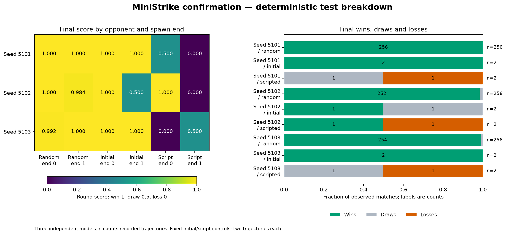
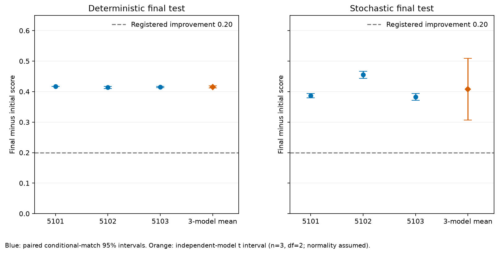

# Stage A confirmation: learning with an unmet combat gate

**Experimental release.** All three fresh seeds completed the registered 5,464,064 arena steps and 667 updates. The mean initial-to-final primary test improvement is **0.415365**, above the registered 0.20 target. The median final moving-script score is **0.25**, below the required 0.55: **engineering acceptance fails**. These statements refer to the fixed-spawn duel, not human-level play, unseen maps, or later stages.

The [protocol](../../../docs/duel-protocol.md), [prospective confirmation resolution](../../../docs/amendments/2026-10-23-confirmation-resolution.md) and [evaluation resolution](../../../docs/amendments/2026-10-23-confirmation-evaluation.md) define the experiment. [Exact raw inputs](data/), [analysis](data/analysis.json), [selection](data/selection.json) and [audit](audit.json) support the numbers below. Training source: `64c366cd43c9739d3596712a4dd277675ecea8aa`; evaluation source: `8b1ae9d6b80c8df5084e57e810a5b00d7403ec34`.

## All independent models

Score means win 1, draw 0.5, loss 0, averaging opponents and spawn ends equally. It is not simply win rate. Each model starts from independent random weights and uses only self-play experience; scripted opponents appear only in evaluation.

| Seed / individual report | Initial test score | Final test score | Paired improvement | Final random | Final initial | Final scripted |
|---|---:|---:|---:|---:|---:|---:|
| [5101](seed5101.md) | 0.333333333 | 0.750000000 | 0.416666667 | 1.000000000 | 1.000000000 | 0.250000000 |
| [5102](seed5102.md) | 0.333333333 | 0.747395833 | 0.414062500 | 0.992187500 | 0.750000000 | 0.500000000 |
| [5103](seed5103.md) | 0.333333333 | 0.748697917 | 0.415364583 | 0.996093750 | 1.000000000 | 0.250000000 |

The independent-model mean improvement is 0.415364583, with a Student-t 95% interval **[0.412130029, 0.418599138]**, three differences and two degrees of freedom. This interval assumes approximately normal independent model differences; three models cannot establish a reliable tail-failure rate. Secondary stochastic deployment improves by 0.408203125, with the wider model interval **[0.307243052, 0.509163198]**. Secondary results never replace the primary criterion. [Analysis and all per-model match intervals](data/analysis.json).

| Pre-specified primary criterion | Measured | Assessment |
|---|---:|---|
| Mean paired improvement >= 0.20 | 0.415364583 | Pass |
| Median final random score >= 0.70 | 0.996093750 | Pass |
| Median final initial-policy score >= 0.70 | 1.000000000 | Pass |
| Median final moving-script score >= 0.55 | 0.250000000 | **Fail** |
| At least 90% of final benchmark rounds end by elimination | 773 / 780 = 0.991025641 | Pass |

Elimination is a fraction of recorded rounds, so the numerous random-policy rounds dominate this measure. Score weights baselines equally. Elimination can include a learner loss or simultaneous lethal draw; it is not a success rate.

## Selection and uncertainty

Validation means were 0.750000000, 0.748046875 and 0.749348958 for seeds 5101, 5102 and 5103. The registered rule selected **5101** at `2026-10-23T07:58:18.828799Z`, before the first final-test access at `07:58:18.849864Z`. The frozen [selection record](data/selection.json) has SHA256 `ff0773ca006c05bf30282eabba4287aeebbb78d74f0be1c4dc16d8030dc39146`. Its `final_test_accessed: false` is a historical assertion at selection time; tests subsequently completed. Every candidate, including weaker models, is published.

The selected final checkpoint SHA256 is `08555d745249be9e49bb4b320f04737c5c5730bb53c39473d5fb4cf16a481ecb`. Selection makes it the reproducible inspection default, not an accepted or generally competent agent. No tuning followed final-test results.

Each deterministic endpoint records 256 random-policy rounds from 128 paired world seeds and two spawn ends, plus **two unique trajectories each** against deterministic initial and scripted policies. Repeating those two fixed trajectories 128 times would not create independent evidence. Stochastic endpoints record 256 rounds for each opponent. All 24 endpoints therefore contain 12,336 round records, split equally between validation root 3,000,000 and test root 4,000,000. Each endpoint retains six prospectively selected first-seed traces. See [evaluation receipt](data/evaluation-receipt.json).

Conditional match intervals resample paired world-seed blocks, retaining spawn-end and initial/final pairing and keeping deterministic cells fixed. They condition on the particular model pair; a zero-width interval does not imply certainty about retraining or new layouts. Independent-model intervals use the three trained-model differences instead. The [power sensitivity](../../../docs/amendments/2026-10-23-confirmation-resolution.md) was prospective, not measured power. Sources: [Colas et al.](https://arxiv.org/abs/1806.08295), [Agarwal et al.](https://arxiv.org/abs/2108.13264), [SciPy Student-t](https://docs.scipy.org/doc/scipy/reference/generated/scipy.stats.t.html).







## Learning, compute and limitations

The actor is a two-layer 128-unit tanh MLP with 192 inputs (four frames), observer-coordinate preprocessing of visible player offsets, and categorical movement/yaw/pitch/fire/reload outputs. The separate two-layer 256-unit critic retains raw observation coordinates. PPO, GAE, R1 outcome/net-damage reward, snapshot selection and all hyperparameters are frozen engineering decisions in the protocol. There are no demonstrations, pretrained gameplay weights, scripted training opponents or automatic aiming/navigation.

Training completed serially in 2,957.813, 2,941.093 and 2,882.594 trainer seconds, respectively, at approximately 1,847, 1,858 and 1,896 arena steps/s. All 2,001 logged optimizer rows have finite recorded metrics. Reported gradient norms are measured **before** the norm-1 clipping operation. Finite losses and falling entropy alone do not establish useful behavior. The stronger evidence is the held-out improvement against fixed benchmarks; the failed script gate limits that conclusion.

The three runs used 16,392,192 arena steps: the same number of learner decisions and twice that number of total player decisions. Each arena step advances one 20-Hz simulation tick. Parallel arenas do not make these counts wall-clock time. Full orchestration, host telemetry, stdout/stderr and per-seed logs are retained in [data](data/). Training ended at 07:44:31 UTC and all endpoints at 08:01:51 UTC, within the unchanged 09:30:52 training and 11:30:52 overall deadlines.

The single exploratory representation seed had beaten every primary validation opponent, but that moving-target performance did **not** reproduce in the fresh confirmation seeds. This is evidence against treating one successful exploratory initialization as a reliable recipe. It does not isolate why the script fails: no new intervention or architecture/reward tuning was performed after final testing. The fixed starts, tiny map, three models and weak random/initial controls limit extrapolation. Later stages remain unexecuted and require new budgets.

## Artifacts and reproduction

[Loss gallery](curves/README.md), [reward/combat/behavior/self-play/optimizer gallery](curves/training/README.md), [primary validation](validation-deterministic.png), [secondary validation](validation-stochastic.png), [secondary test](test-stochastic.png), [native views and replay parity](native/README.md), and [publication verification](../../publication/README.md). These 33 PNG/SVG pairs retain exact input records and derived values; interval rewards are per arena step, not episode returns.

```powershell
uv run python scripts/report_confirmation.py --input runs/duel-fixed-v1/confirmation --output reports/duel-fixed-v1/confirmation
# After cloning, regenerate analysis/plots from the preserved raw report data without training:
uv run python scripts/report_confirmation.py --input reports/duel-fixed-v1/confirmation/data --output runs/reproduced-confirmation
```

The public [selected model](https://huggingface.co/BurnyCoder/ministrike-duel-fixed-v1-seed5101), [5102](https://huggingface.co/BurnyCoder/ministrike-duel-fixed-v1-seed5102) and [5103](https://huggingface.co/BurnyCoder/ministrike-duel-fixed-v1-seed5103) retain every initial/final pair, config, metrics and endpoint. The [paper](../paper.pdf), [editable paper](../paper.md) and [all-experiment summary](../../summary.md) place these results beside all negative diagnostics and deferred work.
