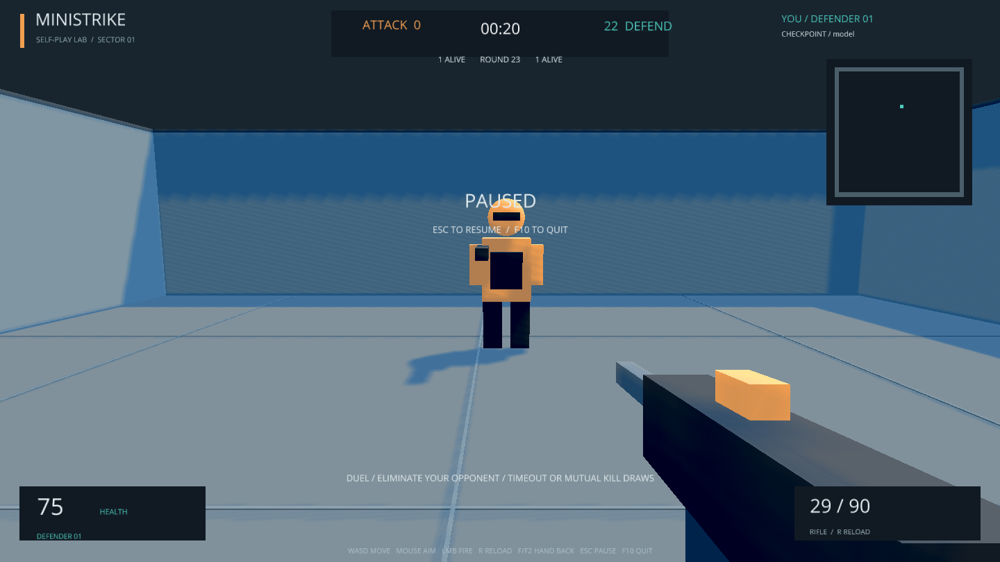

# Native gameplay and replay verification

The validation-selected confirmation checkpoint **seed 5101** was loaded in the Windows Ursina application. It is an experimental model with a failed moving-script acceptance gate, not a diagnostic fixture. Its SHA256 is `08555d745249be9e49bb4b320f04737c5c5730bb53c39473d5fb4cf16a481ecb`. [Complete parity receipt and capture hashes](parity.json).

| Requested mode | Retained evidence | Observation |
|---|---|---|
| Arena spectating | [08:04:28 image](ministrike-20261023T080428Z.png) and adjacent replay | Both players, arena and scoreboard rendered from the shared simulation. |
| First-person bot watching | [08:10:23 image](ministrike-20261023T081023Z.png) and adjacent replay | Bot camera, rifle, crosshair and live HUD; `controlled=null`, `followed=1`, unpaused. |
| Live takeover | [08:09:20 image](ministrike-20261023T080920Z.png) and adjacent replay | Player 1 changes from policy-owned to human-owned while round 23 remains active. |
| Hand-back | [08:09:37 image](ministrike-20261023T080937Z.png) and adjacent replay | Human ownership returns to policy; all simulation fields match the pre-takeover snapshot. |
| Explicit human first-person play | [08:12:24 image](ministrike-20261023T081224Z.png), [final image](native-play-final.png) and adjacent replays | `play --team 1` owns player 1; a mouse firing request is recorded. |




For the ownership check, the game was paused at total tick 397, round 23, round tick 1, with both players at 75 health and 29 ammunition. Switching ownership with F2 and back did not reset or advance the round. The pre/post replay files are byte-identical. Resuming play continued the round normally. Nine captures across the sessions reconstruct **all recorded transitions and final canonical fields exactly** through headless `Simulation.step`; [the verifier](../../../../scripts/verify_native_replays.py) does not call the renderer or use model actions during replay.

Viewer revision `51a6df5398253ca0d4b1efc974ac9838fad1ac75` adds F1/F2 aliases for V/F and capture metadata; the first arena capture preceded that presentation-only change. The aliases address the remote input tool's inability to deliver Ursina letter scan codes, using [Panda3D's documented function keys](https://docs.panda3d.org/1.10/python/programming/hardware-support/keyboard-support). Original keyboard bindings remain supported by the application's input mapping. No trained rule, model or checkpoint was changed.

The two original F10 exit captures show wireframe rendering. Inspection of installed Ursina 8.3.0 found that its separate window input entity handles F10/F12 even with editor UI and development mode disabled; [upstream window controls](https://github.com/pokepetter/ursina/blob/master/ursina/window.py) document that behavior. Revision `2182721` disables that debug input entity so the game's exit and capture handlers own these keys. A further native F10 check produced the [normal shaded exit image](native-exit-fixed.png), a 162-tick replay with exact headless parity, and a clean game exit. The original wireframe captures and full [before/after logs](logs/) remain evidence.

**Scope limitation:** native verification covers cameras, ownership transitions, HUD, rendering, a human firing request and replay equality. The automated native session did not successfully deliver WASD movement or mouse aiming; those input mappings are covered by focused renderer/controller tests, not an end-to-end physical keyboard/mouse test. The observed stationary human dying is not a human-skill benchmark. These limitations are retained rather than describing the session as exhaustive manual playtesting.

```powershell
uv run csrl watch --experiment duel-fixed-v1 --checkpoint runs/duel-fixed-v1/confirmation/seed5101/model.pt
uv run csrl watch --experiment duel-fixed-v1 --checkpoint runs/duel-fixed-v1/confirmation/seed5101/model.pt --first-person
uv run csrl play --experiment duel-fixed-v1 --checkpoint runs/duel-fixed-v1/confirmation/seed5101/model.pt --team 1
```

Tab cycles living bots; V/F1 switches view; F/F2 takes over or hands back; Escape pauses; F12 captures a PNG/replay; F10 exits. The same state, ammunition and ongoing round survive a takeover. The [real optimizer resume audit](../../egocentric-v1/resume.md) is separate from these presentation checks and covers exact equality over two production updates.
