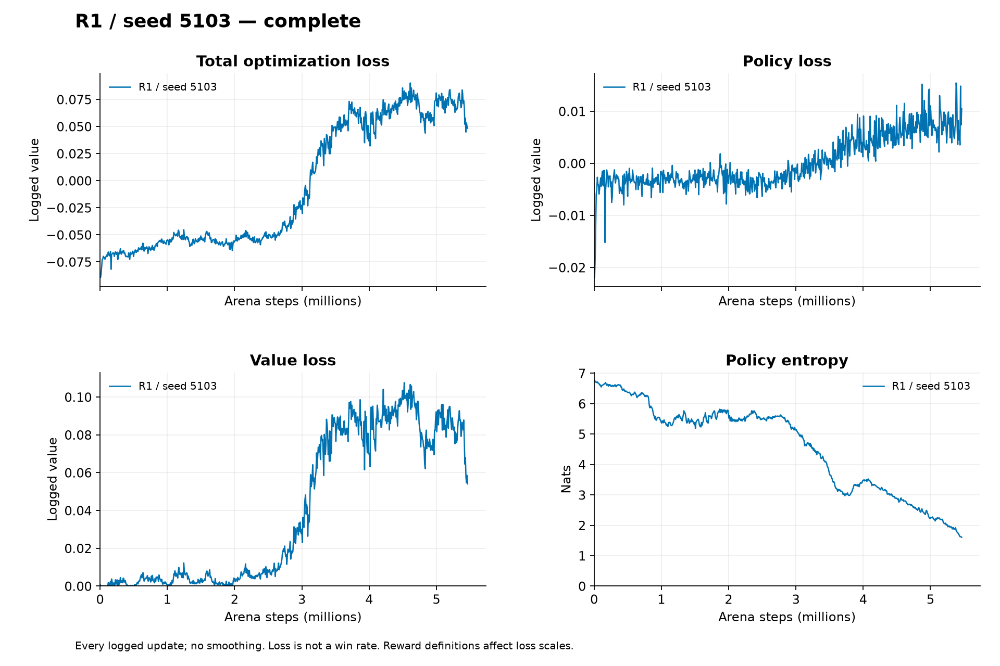

# Confirmation seed 5103

**Experimental: the three-model release fails the moving-script acceptance criterion.** This independent scratch run completed 5,464,064 arena steps and 667 updates in 2882.594 trainer seconds. No replacement seed or extension was used. Training revision `64c366cd43c9739d3596712a4dd277675ecea8aa`. [Exact config](data/seed5103/config.json), [result](data/seed5103/result.json) and [metrics](data/seed5103/metrics.jsonl).

## Method and rationale

The [registered protocol](../../../docs/duel-protocol.md) fixes the symmetric 14 m arena, six-metre opposing starts, 20 Hz elimination, PPO/GAE, R1 outcome/net-damage reward and scratch historical self-play. The actor has 192 local-history inputs, an observer-coordinate transform and 2x128 tanh hidden units; the separate critic has 2x256 tanh units and original input coordinates. Neither demonstrations nor scripted opponents enter training. The [confirmation resolution](../../../docs/amendments/2026-10-23-confirmation-resolution.md) explains the equal budget, 20% time reserve, independent seeds and pre-specified thresholds. All hyperparameters are engineering decisions.

## Every measured endpoint

| Split / mode / endpoint | Mean score | Random | Initial | Script | Elimination |
|---|---:|---:|---:|---:|---:|
| validation / deterministic / initial | 0.333333333 | 0.500000000 | 0.500000000 | 0.000000000 | 0.007692308 |
| validation / deterministic / final | 0.749348958 | 0.998046875 | 1.000000000 | 0.250000000 | 0.996153846 |
| validation / stochastic / initial | 0.332682292 | 0.500000000 | 0.498046875 | 0.000000000 | 0.337239583 |
| validation / stochastic / final | 0.716796875 | 1.000000000 | 1.000000000 | 0.150390625 | 1.000000000 |
| test / deterministic / initial | 0.333333333 | 0.500000000 | 0.500000000 | 0.000000000 | 0.007692308 |
| test / deterministic / final | 0.748697917 | 0.996093750 | 1.000000000 | 0.250000000 | 0.992307692 |
| test / stochastic / initial | 0.333333333 | 0.500000000 | 0.500000000 | 0.000000000 | 0.333333333 |
| test / stochastic / final | 0.716145833 | 1.000000000 | 0.998046875 | 0.150390625 | 0.998697917 |

Primary paired improvement: **0.415364583**; conditional match 95% interval `[0.4134114583333333, 0.41666666666666663]`. This interval conditions on this one initial/final pair; the separate three-model analysis is in [the aggregate report](README.md). Fixed deterministic initial/script controls each supply two trajectories; random and all stochastic endpoints use 128 paired seeds/256 rounds per opponent.

[All raw endpoint records](data/seed5103/) include wins/losses/draws, sides, damage, accuracy, kills, reload, aim saturation, inactivity and first-seed traces. [Audit](audit.json) binds every endpoint and checkpoint hash.

[Reward/combat/behavior/optimizer graphs](curves/training/README.md). Reward curves are interval means per arena step, not episode returns. Self-play opponents change.

## Interpretation

The model improves against the registered aggregate, but does not establish robust moving-target combat. A success on this fixed layout does not establish unseen-spawn or map generalization. No additional tuning followed final tests. See [sources](../../../docs/sources.md) for algorithm/API references and [the aggregate](README.md) for uncertainty and failed gates.
