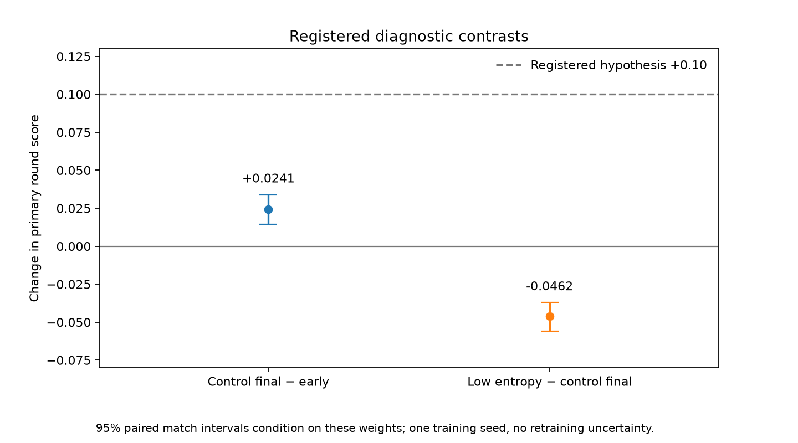

# Duration and entropy diagnostics: complete, no qualifying recipe

Both scratchseed5201 runs completed4,980,736arena steps, followed by all12 registered validation endpoints. Neither +0.10 diagnostic hypothesis passed. Neither recipe met the conservative screen for fresh-seed confirmation. These are **experimental diagnostic artifacts**, not qualified gameplay bots. No final-test data was accessed. [Prospective registration](../../../docs/amendments/2026-10-23-duration-entropy-diagnostic.md), [exact analysis](data/analysis.json), [numerical/hash audit](audit.json).

| Primary deterministic metric | R1 control, entropy0.01 | R1 low entropy0.001 |
|---|---:|---:|
|Initial aggregate round score |0.33333333|0.33333333|
|Early score,1,245,184steps |0.39648438|0.33854167|
|Final score,4,980,736steps |0.42057292|0.37434896|
|Own initial-to-final change |+0.08723958|+0.04101563|
|Final score versus random |0.76171875|0.62304688|
|Final score versus initial |0.50000000|0.50000000|
|Final score versus moving script |0|0|
|Benchmark rounds ending by elimination |52.31%|25.00%|
|Recipe screen |failed|failed|

Round score is win1/draw0.5/loss0, equally weighted across the three baselines and both spawn ends. Random has256 matches (128 paired seeds×2ends); deterministic initial/script each has two fixed trajectories, **not256 independent replications**. The elimination percentage is over all recorded rounds, as specified by the evaluator. [Control raw final](data/control/seed5201/final_validation.json), [low-entropy raw final](data/low-entropy/seed5201/final_validation.json).

The registered **duration contrast**, control final minus early, is **+0.02408854**, conditional95%paired-match interval **[+0.01432292,+0.03385417]**. The **entropy contrast**, low minus control final, is **−0.04622396**, interval **[−0.05598958,−0.03710938]**. These intervals use5,000paired seed-block resamples; they condition on these checkpoints. There is only **one matched training seed**, so neither interval measures variability across independently trained models. Both measured improvements fall below+0.10. [Analysis](data/analysis.json), [analysis implementation](../../../src/ministrike/experiments/duel_analysis.py), [uncertainty methodology](https://arxiv.org/abs/2108.13264).

Secondary stochastic final scores are0.63802083(control) and0.46549479(low entropy). The control wins234/256random matches and232/256initial-policy matches, but only **1/256scripted matches**; low entropy wins0/256scripted matches. This supports learning against weak controls under sampling, while useful moving-opponent combat remains unsupported. The secondary mode cannot override the primary gate. [All secondary summaries](data/analysis.json), [stochastic side/count plot](validation-stochastic-breakdown.png).

## Design, integrity and interpretation

Both runs start from identical actor/critic tensors, use the same R1 reward, PPO settings, MLP architecture, map, action decoder, self-play pool and equal arena-step budget. Only the entropy coefficient differs. Original hyperparameters are engineering decisions in the registration; [the literature motivated the question, not its answer](../../../docs/sources.md). Each run used one CUDA learner/64arenas/one CPU thread and CPU frozen opponents. Source revision `b830c3223f3f931e953051755259e8ade44e5bdc`; configuration SHA256 `9189f25059c60d2b1898936f2306e57d1c5c5811ac86bd3b8d491bdfb66c1432`. [Resolved config and host receipts](data/execution/).

The control's first152 updates reproduce the original R1 pilot's learning/counter metrics exactly, excluding wall-clock fields, and its early actor/critic tensors match that pilot's final tensors. All12 summaries reconstruct from raw match rows; all evaluated checkpoint hashes match the saved receipt. This supports the intended controlled comparison and reproducibility of that prefix; it does not prove the entire learning system bug-free. [Audit](audit.json), [evaluation receipt](data/evaluation-receipt.json).

Longer exposure helped less than the registered threshold. Lower entropy produced a lower final logged total loss (0.00285582 versus0.01132775) and lower entropy (2.13839179 versus3.15545812), yet worse primary score. Total losses also contain differently weighted entropy terms, so their magnitudes are not a model-quality ranking. No observation here establishes why the policies fail against the script, or that every longer duration/entropy setting would fail. [Raw control metrics](data/control/seed5201/metrics.jsonl), [raw low-entropy metrics](data/low-entropy/seed5201/metrics.jsonl).

Individual reports: [duration control](duration-R1.md) and [entropy intervention](entropy-R1.md). Next prospective investigation is [observer-coordinate inputs with a real resume prerequisite](../../../docs/amendments/2026-10-23-egocentric-diagnostic.md); it does not overwrite these failed hypotheses.

## Figures and reproducibility

There are23PNG/SVG pairs: three loss plots, fifteen reward/combat/behavior/self-play/optimizer plots, four endpoint/side-count plots and the contrast plot. [Loss gallery](curves/README.md), [training telemetry gallery](curves/training/README.md), [primary endpoints](validation-deterministic.png), [primary spawn/WDL](validation-deterministic-breakdown.png), [secondary endpoints](validation-stochastic.png). Reward plots difference cumulative counters and divide by interval arena steps; they are not episode returns. Self-play curves use changing opponents, so fixed benchmark scores answer a different question.

Reproduce from the retained run/checkpoint bundle with `uv run python scripts/report_duration_entropy.py`. The reporter verifies checkpoint/tensor identities, reconstructs every summary and both registered contrasts, copies raw data byte-for-byte and emits input/figure SHA256 records. Source identities and original timestamps remain in the artifacts. Reproducing the full checkpoint audit requires the checkpoints, published separately from Git. Validation started03:27:40UTC and completed03:33:35UTC on2026-10-23, within its persisted900second cutoff. Absolute Stage A deadline remains11:30:52.627932UTC; no clock was extended.
