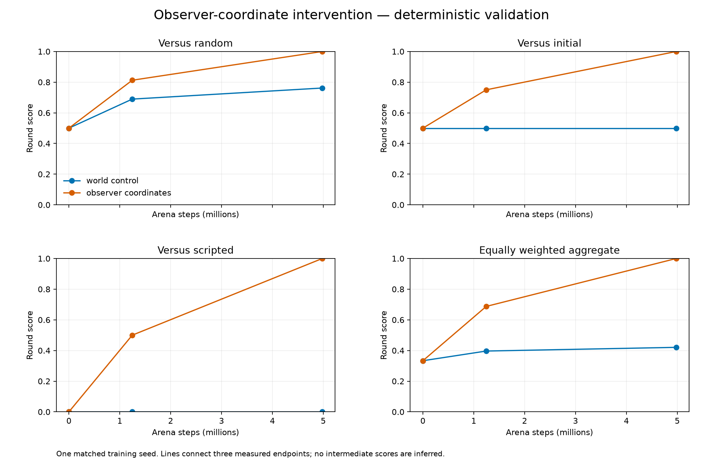
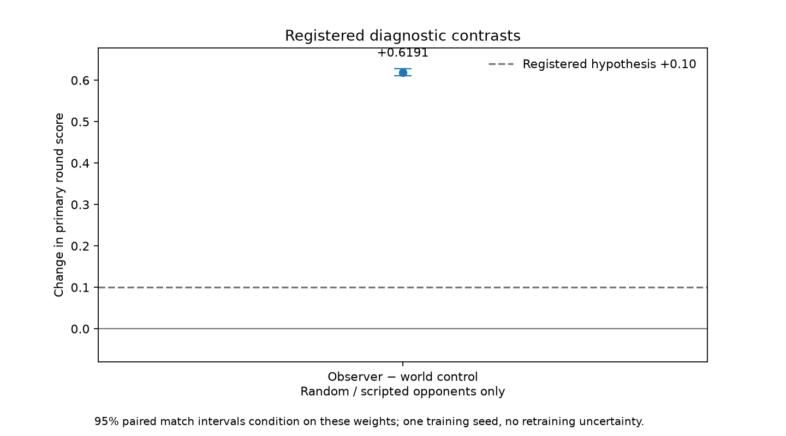
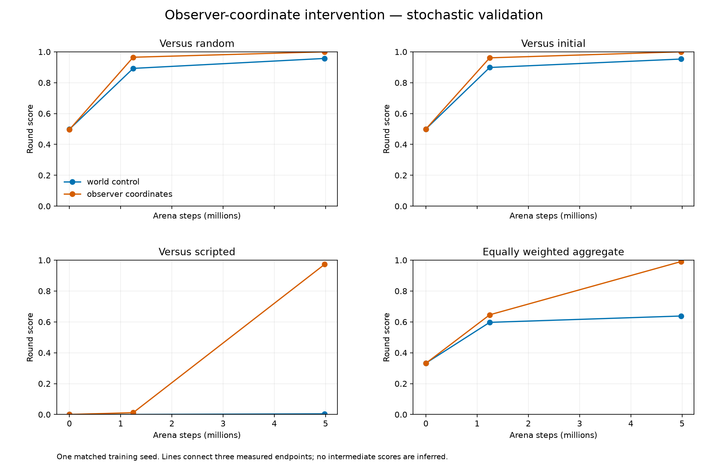

# A-DIAG-EGO-R1: observer-coordinate input comparison

The registered input intervention passed its single-seed diagnostic screen. **This qualifies a recipe for fresh confirmation; this diagnostic model cannot deploy.** All numbers below come from the adjacent [raw endpoints](data/egocentric/seed5201/), [registered analysis](data/egocentric/analysis.json) and [reproduction/hash audit](audit.json). Training source`6149c2ddef0c987c08005544a855aa00c60f329f`, seed5201, config[duel-egocentric-R1.json](data/execution/duel-egocentric-R1.json).

## Method and causal comparison

The [prospective protocol](../../../docs/amendments/2026-10-23-egocentric-diagnostic.md) changes only actor preprocessing: each history frame's already-visible player displacement rotates from world axes into the observer's right/up/forward basis. It adds no hidden fields, angle-error target, aiming assistance or demonstrations. The raw critic inputs,192actor inputs,2×128/tanh actor,2×256/tanh critic, five categorical controls, PPO/GAE/Adam, R1 reward, historical self-play and initial parameter tensors are unchanged. [Implementation](../../../src/ministrike/learning/observation_transform.py), [design rationale and primary sources](../../../docs/shooter-rl-design-review.md).

Both this run and the reused [world-coordinate duration control](../duration-entropy-v1/duration-R1.md) trained from scratch for4,980,736arena steps/608updates, retaining update152 at1,245,184steps. Initial actor and critic fingerprints match exactly, but initial behavior need not match after preprocessing. The primary cross-representation comparison therefore uses **random and scripted opponents only**: the corresponding initial policy changes behavior with the representation and would confound that contrast. Its within-model score remains part of the separately registered qualification screen. Network widths and other numerical choices are engineering decisions, not literature-derived optima.

The worker completed in2,737.828trainer seconds; group wall time2,749.968seconds, exit0. All six endpoints completed04:59:56–05:02:08UTC within the persisted900-second allowance. All608 recorded loss/gradient/entropy/KL/clip values are finite. [Worker result](data/egocentric/seed5201/result.json), [host telemetry](data/execution/egocentric-R1.json), [evaluation receipt](data/egocentric/evaluation-receipt.json). No interruption, retraining or final-test access occurred in this diagnostic.

## Primary deterministic validation

Round score is win1, draw0.5, loss0, averaged equally across opponents and ends. The random controller generates128paired seed worlds; deterministic initial/scripted controllers yield only one trajectory per spawn end. Every endpoint and both ends are retained.

| Checkpoint | Arena steps | Random score | Corresponding initial score | Script score | Equal-opponent mean | Elimination fraction |
|---|---:|---:|---:|---:|---:|---:|
|Initial |0|0.500000|0.500000|0.000000|0.333333|0.007692|
|Early |1,245,184|0.812500|0.750000|0.500000|0.687500|0.626923|
|Final |4,980,736|1.000000|1.000000|1.000000|1.000000|1.000000|

Final wins are256/256 against random,2/2 against initial and2/2 against the script; no draws or losses. Both spawn-end scores are1.0 for every baseline. Mean simulated duration against random/initial/script is0.931836/1.25/0.8seconds. This small deterministic script sample is two fixed trajectories, not evidence about arbitrary combat situations. [All primary rows and traces](data/egocentric/seed5201/final_validation.json).

The registered final external-control gain over the world-coordinate model is **+0.619140625**, conditional95% paired match interval**[0.6103515625,0.6279296875]**, exceeding the+0.10 hypothesis. Own-initial improvement is**+0.666666667**. Its conditional bootstrap interval collapses to the same value because every random initial/final pair changes from draw to win and the deterministic cells remain fixed. This is not zero uncertainty about independent retraining or unseen situations. Neither interval measures training-seed variability. [Analysis](data/egocentric/analysis.json), [estimator](../../../src/ministrike/experiments/duel_analysis.py).

The initial-opponent and three-opponent panels show each model's corresponding baseline and are descriptive across representations. Only the random/script contrast below estimates the registered cross-representation effect. Lines connect measured endpoints; no intermediate evaluations are inferred.

## Secondary stochastic behavior

| Checkpoint | Random score | Initial score | Script score | Mean | Elimination fraction |
|---|---:|---:|---:|---:|---:|
|Initial|0.496094|0.500000|0.000000|0.332031|0.335938|
|Early|0.964844|0.960938|0.011719|0.645833|0.950521|
|Final|1.000000|1.000000|0.972656|0.990885|1.000000|

The final sampled actor wins256/256 random and256/256 initial matches; versus the script it records247wins,4simultaneous-elimination draws and5losses in256matches. Script side scores are0.9609375 and0.984375. These are secondary outcomes and did not replace the deterministic selection rule. [Raw secondary rows](data/egocentric/seed5201/final_validation_stochastic.json).

## Loss, reward and behavior

[Loss components](curves/seed5201.png), [reward](curves/training/seed5201-rewards.png), [combat](curves/training/seed5201-combat.png), [reload/aim/inactivity/timeouts](curves/training/seed5201-behavior.png), [changing self-play outcomes](curves/training/seed5201-selfplay-outcomes.png), [optimizer/throughput](curves/training/seed5201-optimization.png), [primary spawn/WDL](validation-deterministic-breakdown.png) and [secondary spawn/WDL](validation-stochastic-breakdown.png) retain all recorded points and exact input hashes. All11figures also have adjacent SVG versions. [Graph units and limitations](../../../docs/experiment-plots.md).

Final total loss0.10975936, value term0.12192507, policy term0.00658013, entropy1.87458370 and pre-clipping gradient norm4.01116929 are optimizer diagnostics, not error percentages or proof of skill. The norm is measured before the1.0clip. Reward curves are differences of cumulative component counters divided by interval arena steps, not episode returns. Training opponents change over time. Useful learning is supported here by the registered frozen benchmark outcomes, even though the total loss did not simply decrease. [Exact metrics](data/egocentric/seed5201/metrics.jsonl), [TorchRL loss interpretation](https://docs.pytorch.org/rl/stable/reference/generated/torchrl.objectives.ClipPPOLoss.html).

## Interpretation, limitations and next step

The controlled result supports the observer-coordinate representation **for this matched seed, fixed arena and finite budget**. It does not identify every internal mechanism, establish generalization, compare architectures/algorithms, or prove that previous failures were software bugs. Self-play opponent behavior also changes as a consequence of the representation treatment; this is the tested training recipe, not an actor-only evaluation swap. The script is a simple legal benchmark and can be exploited in fixed geometry. Three fresh confirmation seeds are required to assess reproducibility. [Separate confirmation resolution](../../../docs/amendments/2026-10-23-confirmation-resolution.md).

The successful [real optimizer resume prerequisite](resume.md) is a separate correctness control. Its two-update scope must not be confused with a long interruption-recovery guarantee. Earlier reward, inference-mode, duration and entropy failures remain in the [experiment evidence index](../../../docs/evidence-index.md).

## Reproduce and provenance

`uv run python scripts/report_egocentric.py` checks initial fingerprints, all evaluated checkpoint hashes, all raw summaries and the registered paired analysis, then copies43raw records and renders11PNG/SVG pairs. It runs no gameplay, optimizer or final-test evaluation. It uses the local runs and model binaries; the raw bundles permit direct JSON/analysis inspection in a clone, while tensor checks require the corresponding published checkpoints. [Reporter](../../../src/ministrike/experiments/egocentric_reporting.py), [audit with hashes and plotted values](audit.json).

All36 prospectively selected first-seed traces remain inside the six raw endpoint files; none was selected after seeing success. Initial/final checkpoint SHA256 are`173f7fdefce9de1bc4cc4c242f3da4e4e26c8de2b97b4c8ddd825c36394157a1` and`79665c155698f57de9cda2ddd38bcaed4fc2e2423abbdf97561384be9ad74002`. Report generation source is recorded independently of training in the audit. External methods and license boundaries are centralized in the [bibliography](../../../docs/sources.md).
