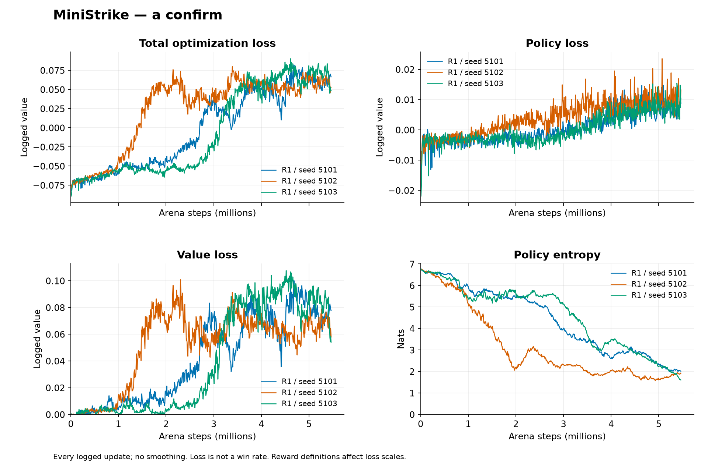
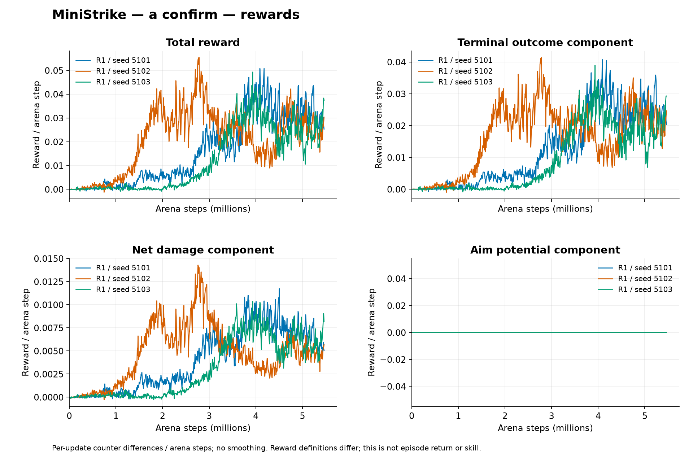

# MiniStrike: staged self-play for fixed-spawn shooter combat

Libor Burian

23 October 2026. Experimental software and empirical report. Canonical [source and registrations](https://github.com/BurnyCoder/3d-firstperson-shooter-reinforcement-learning-selfplay), [all-experiment ledger](../summary.md), [public models](https://huggingface.co/collections/BurnyCoder/ministrike-staged-shooter-self-play-6ada65970d163e293d48f3ad).

## Abstract

We investigate whether scratch self-play can learn useful combat in a small, fixed-spawn 1v1 first-person shooter under a separately recorded 12-hour wall-clock allowance. The simulator, renderer, evaluator and training adapter share one transition implementation. A local-observation multilayer perceptron is trained with TorchRL PPO and a separate critic. Three reward pilots, an inference-mode intervention, a longer-duration control and a lower-entropy control failed their registered diagnostic thresholds. Rotating already-visible relative player positions into the observer's coordinate frame produced a large improvement in one matched exploratory seed. Three fresh confirmation models then completed 5,464,064 arena steps each. Their mean initial-to-final primary final-test round-score improvement was 0.415365, with a model-level Student-t 95% interval [0.412130, 0.418599]. Median final scores against random, initial and moving scripted opponents were 0.996094, 1.000000 and 0.250000. The pre-specified improvement target was met, but the scripted-opponent criterion of 0.55 was not. We release all models as experimental, preserve negative findings and incomplete advanced 5v5 work, and distinguish conditional match uncertainty from uncertainty across independently trained models. These fixed-layout results do not establish generalization to new starts, maps or human opponents.

## Motivation and scope

The approved project requirements call for an original local shooter, bots trained without demonstrations or imitation, reproducible evaluation, progressively harder tasks, and public evidence including failures. Stage A is fixed-spawn 1v1 elimination in a flat symmetric arena. Later registered stages add randomized starts, tactical geometry, fixed-count and variable-count free-for-all, 3v3 team elimination, bomb objectives and eventually 5v5. Each later stage requires a separate budget and protocol; none is implicitly executed by this report. The earlier advanced suite is preserved as deferred evidence, not mixed into Stage A training or analysis. [Roadmap](../../docs/experiment-roadmap.md), [approved Stage A protocol](../../docs/duel-protocol.md).

The scientific question is narrower than building a generally competent shooter agent: does the frozen recipe improve a pre-specified fixed-benchmark score from initialization, and does it clear practical combat thresholds across fresh model seeds? We do not assume that decreasing loss, self-play wins or high GPU utilization answer that question. The single successful exploratory representation seed is explicitly separated from independent confirmation. This separation follows the motivation for careful few-run RL evaluation discussed by [Agarwal et al.](https://arxiv.org/abs/2108.13264) and seed sensitivity discussed by [Colas et al.](https://arxiv.org/abs/1806.08295).

## Related shooter systems and design choices

Sample Factory demonstrated large-scale Doom self-play using asynchronous PPO with V-trace correction, convolutional visual encoders, recurrent memory, factorized controls and population-based training. Its supplement describes a 512-unit GRU and separate nonvisual feature processing. We borrow the ideas of discrete control factors, diverse frozen opponents and end-to-end throughput measurement; we do not reproduce its engine, observation modality, training scale or population optimization. The reported large frame budgets cannot predict learning time in MiniStrike. [Petrenko et al., main paper](https://proceedings.mlr.press/v119/petrenko20a/petrenko20a.pdf), [supplement](https://proceedings.mlr.press/v119/petrenko20a/petrenko20a-supp.pdf).

Quake III capture-the-flag agents used visual encoders, fast/slow recurrent computation, memory, population training and actor-critic learning with off-policy correction. Unity's DodgeBall work uses ray observations and team-oriented representations/credit assignment; MA-POCA addresses cooperative credit across changing agent participation. These motivate later recurrence, masked entity representations and team experiments rather than replacing several mechanisms at once in the flat duel. [Jaderberg et al.](https://arxiv.org/abs/1807.01281), [Unity DodgeBall](https://unity.com/blog/engine-platform/ml-agents-plays-dodgeball), [MA-POCA](https://arxiv.org/abs/2111.05992). Exact architecture/input/output comparisons and source limitations are centralized in the [design review](../../docs/shooter-rl-design-review.md).

The two-layer MLP sizes, four-frame history, PPO hyperparameters, reward coefficients and acceptance thresholds are **registered engineering decisions**, not literature-established optima. A relative coordinate representation is consistent with [Unity's vector-observation guidance](https://unity-technologies.github.io/ml-agents/Learning-Environment-Design-Agents/#vector-observation-summary-best-practices), but its usefulness here is assessed by the local intervention. No recurrent, wider-network, finer-action-bin or alternative-algorithm experiment was run in confirmation.

## Game and authoritative simulation

The arena has a 14 by 14 metre flat interior, perimeter walls and no internal obstacles. Players start six metres apart facing each other, with the learner's spawn end alternated. Each has 100 health, a rifle dealing 25 effective damage per hit, a 30-round magazine, 90 reserve rounds, configured six-shot-per-second cadence and a two-second reload. The simulation runs at 20 Hz for at most 20 seconds. There are no respawns, bomb objectives, interaction, pickups, jumping or crouching in Stage A. Killing the other player wins; simultaneous lethal shots and timeout draw. The same collision, visibility, ray obstruction and simultaneous damage rules serve headless and rendered execution. [Match and rule specification](../../docs/duel-protocol.md), [simulation architecture](../../docs/architecture.md).

One NumPy transition implementation owns physics and randomness. Ursina renders state and supplies human input but does not determine hits. TorchRL batches independent arenas and resets only completed ones. Checkpoints identify match, observation, action and reward versions, so incompatible legacy models cannot silently run under duel rules. These interface choices implement the approved project requirements and the [TorchRL EnvBase contract](https://docs.pytorch.org/rl/stable/reference/generated/torchrl.envs.EnvBase.html). Original simple visual assets and the [Ursina FPS example](https://github.com/pokepetter/ursina/blob/master/samples/fps.py) inform presentation; game mechanics are implemented in the shared simulator.

## Observations, actions and networks

The actor receives 192 values: four frames of 48 local features containing personal state, public geometry and visible players. Hidden opponents' dynamic fields are masked. It has two 128-unit tanh hidden layers and factorized categorical heads with 9 movement, 5 yaw, 5 pitch, 2 firing and 2 reload choices. The disabled interaction head contributes no entropy term. There is no scripted aiming, navigation or hidden-opponent input in inference. The separate critic has two 256-unit tanh hidden layers; in the duel it receives the single learner's observations, while team stages use the learner team's combined observations. [Protocol](../../docs/duel-protocol.md), [implementation](https://github.com/BurnyCoder/3d-firstperson-shooter-reinforcement-learning-selfplay/tree/64c366cd43c9739d3596712a4dd277675ecea8aa/src/ministrike/learning).

The successful diagnostic changed only the actor preprocessing: already-visible world-relative XYZ offsets are rotated into each history frame's own right/up/forward basis. The actor input count, parameter shapes, original initialization fingerprints, action outputs, critic inputs, reward and PPO settings remained fixed. This supplies no extra state and computes no aim action. The fixed corresponding-initial opponent changes behavior under this transformation, so the primary cross-representation contrast includes only unchanged random and scripted benchmarks. [Prospective intervention](../../docs/amendments/2026-10-23-egocentric-diagnostic.md), [raw diagnostic audit](egocentric-v1/audit.json).

## Learning algorithm, self-play and reward

Training reuses TorchRL collection, generalized advantage estimation and clipped PPO loss machinery. PPO alternates experience collection and minibatch optimization of a clipped probability-ratio surrogate. The multi-agent organization follows a shared actor with a separate centralized training critic; for one learner the team dimension is one. No new optimizer or bespoke replacement for PPO was introduced. [Schulman et al.](https://arxiv.org/abs/1707.06347), [MAPPO](https://arxiv.org/abs/2103.01955), [official TorchRL tutorial](https://docs.pytorch.org/rl/stable/tutorials/multiagent_ppo.html). The pinned runtime uses Python 3.12, PyTorch 2.14.1 with CUDA 13.0 and TorchRL 0.14; exact dependencies are in [uv.lock](../../uv.lock).

| Frozen confirmation setting | Value |
|---|---|
| Optimizer and learning rate | Adam, 0.0003 |
| PPO clip / epochs | 0.2 / 3 |
| Rollout / minibatch | 128 ticks / 256 arena-time rows |
| Discount / GAE lambda | 0.999 / 0.95 |
| Entropy / critic coefficient | 0.01 / 0.5 |
| Gradient norm limit | 1.0; telemetry reports the pre-clipping norm |
| Arenas / CPU threads | 64 / 1 |
| Learner / frozen opponents | CUDA inference and optimization / CPU inference |
| Snapshot cadence / history | Every ten updates / eight rolling candidates plus permanent initial |

The reward is terminal outcome (+1 win, -1 loss, 0 draw) plus alpha times net effective damage divided by 100. Damage is capped by remaining victim health. R0 sets alpha to 0.25; R1 sets 0.50. R2 adds discount times next potential minus current potential, with potential 0.1 times max(0, cosine of angular error to the visible unobstructed opponent centre), zero when hidden and at terminal states. The discounted telescoping identity, including termination, is tested. Potential shaping follows [Ng et al.](https://people.eecs.berkeley.edu/~russell/papers/icml99-shaping.pdf); the chosen potential and coefficients are local engineering choices. Confirmation uses R1, without potential shaping or separate movement/survival/firing/ammunition rewards.

Each arena contains one learner and one frozen opponent. Opponents are selected only at round boundaries: 50% latest snapshot, 50% historical pool. Snapshots are immutable during rounds. Each independent seed has its own randomly initialized model, optimizer, RNG state and opponent pool. Training uses no human data, imitation targets, pretrained gameplay weights, scripted training opponents or transferred diagnostic weights. Dead-player slots and round termination remain distinct in the general adapter; post-death actor terms are masked while delayed team returns and critic learning remain. Time-axis, masking, termination, ratio and gradient-direction checks are retained in [tests](../../tests/).

## Registered sequence and execution accounting

Stage A's absolute clock started at the first published calibration optimizer update, `2026-10-22T23:30:52.627932Z`, and ends at `2026-10-23T11:30:52.627932Z`. The training boundary is 09:30:52 UTC. Calibration, pilots, diagnostics, interruptions, reporting and evaluation consume this allowance; resume cannot reset it. Implementation and resolved configurations were pushed before optimizer-bearing experiments. Original registrations remain intact, with dated amendments and separate experiment identities. [Roadmap](../../docs/experiment-roadmap.md), [execution manifest snapshot](confirmation/data/execution/manifest.json).

The initial two-hour pilot allocation tested R0, then R1 and R2 after failure. Each used scratch seed 5201, identical initial actor/critic tensors and 1,245,184 arena steps. None reached its primary improvement gate of 0.10. Subsequent interventions were registered within the remaining allowance, using no final-test data. Longer-duration and lower-entropy runs each used 4,980,736 steps. The observer-coordinate diagnostic used the same target and passed a conservative recipe screen. Only then were three fresh confirmation runs resolved using the remaining time, calibrated throughput and 20% reserve. Their equal target was 5,464,064 steps; no weak seed was replaced or extended. [Confirmation resolution and prospective power](../../docs/amendments/2026-10-23-confirmation-resolution.md).

## Exploratory findings, including negatives

| Intervention | Registered primary contrast | Measured effect | Outcome |
|---|---|---:|---|
| R0 | Final minus initial mean score >= 0.10 | 0.012370 | Fail |
| R1 | Same gate, stronger damage shaping | 0.063151 | Fail |
| R2 | Same gate, added aim potential | 0.052734 | Fail |
| Learner sampling mode | Learner-only sampling effect >= 0.10 | 0.016927 | Fail |
| Fourfold duration | Final minus early score >= 0.10 | 0.024089 | Fail |
| Entropy 0.001 | Low-entropy minus control >= 0.10 | -0.046224 | Fail |
| Observer coordinates | External random/script gain >= 0.10 | 0.619141 | Pass in one matched seed |

Sources for every row: [R0](pilot-R0.md), [R1](pilot-R1.md), [R2](pilot-R2.md), [action modes](action-modes-v1.md), [duration/entropy](duration-entropy-v1/README.md), [observer coordinates](egocentric-v1/README.md). Conditional paired-match 95% intervals are [0.001953, 0.031901] for the sampling effect, [0.014323, 0.033854] for duration, [-0.055990, -0.037109] for entropy, and [0.610352, 0.627930] for observer coordinates. These are not uncertainty across independently trained models. All 774 repeated action-mode control records reproduced exactly. The duration control reproduced the original R1 tensors at update 152 before attribution.

The original raw-coordinate duration control finished with primary random/initial/script scores 0.761719/0.5/0 and elimination fraction 0.523077. Its secondary stochastic scripted evaluation includes one win in 256 rounds; therefore a blanket claim that every diagnostic scripted match was lost would be false. The observer-coordinate diagnostic finished with all three primary scores equal to one and 247 wins, four draws and five losses in 256 secondary scripted rounds. These findings qualified a recipe, not deployment of the diagnostic checkpoint. [Duration raw analysis](duration-entropy-v1/data/analysis.json), [representation raw analysis](egocentric-v1/data/egocentric/analysis.json).

## Confirmation evaluation and statistical analysis

The three independent scratch seeds are 5101, 5102 and 5103. Every initial/final checkpoint was evaluated against a reproducible random policy, its corresponding frozen initial policy and a frozen moving scripted combat benchmark. The script uses legal local observations and the same categorical action decoder, including quantized aim. Scores weight opponents and spawn ends equally. Validation uses root 3,000,000; final testing uses root 4,000,000. Deployment argmax is primary; categorical sampling is a separate secondary analysis. [Frozen evaluation protocol](../../docs/amendments/2026-10-23-confirmation-evaluation.md).

Where randomness changes trajectories, evaluation uses 128 paired seeds and two spawn ends per opponent. Deterministic fixed-spawn initial/script controls each supply only two unique trajectories, not 256 independent repetitions. Each primary endpoint therefore contains 260 rounds and each stochastic endpoint 768; 24 endpoints retain 12,336 round records and 144 prospectively chosen first-seed traces. Final-test results were first accessed after validation selection was written and hashed: seed 5101 was frozen at 07:58:18.828799 UTC; testing began at 07:58:18.849864 UTC. All three models were then tested. [Selection](confirmation/data/selection.json), [receipt](confirmation/data/evaluation-receipt.json), [audit](confirmation/audit.json).

The primary hypothesis is mean paired model improvement of at least 0.20. Separate engineering gates require median final score at least 0.70 against random and initial policies, at least 0.55 against the moving script, and at least 90% of benchmark rounds ending through elimination. Prospective sensitivity for a 0.20 effect with three paired model differences, two-sided alpha 0.05 and assumed between-model standard deviations 0.05/0.10/0.20 gives power 0.908489/0.470749/0.179255. These are assumptions, not measured post-hoc power. [Published calculation](../../docs/amendments/2026-10-23-confirmation-resolution.md), [Colas et al.](https://arxiv.org/abs/1806.08295).

We report a Student-t interval over three independent model differences, with two degrees of freedom and approximate normal-difference assumption. Conditional match intervals use 5,000 paired block bootstrap resamples, preserving world-seed, side and endpoint pairing while keeping deterministic cells fixed. The two intervals answer different questions. Degenerate match intervals do not remove retraining uncertainty or establish out-of-distribution competence. [Analysis implementation](https://github.com/BurnyCoder/3d-firstperson-shooter-reinforcement-learning-selfplay/blob/8b1ae9d6b80c8df5084e57e810a5b00d7403ec34/src/ministrike/experiments/duel_analysis.py), [SciPy t distribution](https://docs.scipy.org/doc/scipy/reference/generated/scipy.stats.t.html), [Agarwal et al.](https://arxiv.org/abs/2108.13264).

## Confirmation results

| Seed | Initial score | Final score | Improvement | Final random / initial / script |
|---|---:|---:|---:|---|
| 5101 | 0.333333 | 0.750000 | 0.416667 | 1.000000 / 1.000000 / 0.250000 |
| 5102 | 0.333333 | 0.747396 | 0.414063 | 0.992188 / 0.750000 / 0.500000 |
| 5103 | 0.333333 | 0.748698 | 0.415365 | 0.996094 / 1.000000 / 0.250000 |

Every number is primary final-test data; individual endpoints, damage, accuracy, inactivity, reload, aim saturation, win/draw/loss and side breakdowns appear in the [5101](confirmation/seed5101.md), [5102](confirmation/seed5102.md) and [5103](confirmation/seed5103.md) reports and raw records. Mean improvement is 0.415364583 with model-level 95% interval [0.412130029, 0.418599138]. The point target is met; the parametric interval also lies above 0.20, conditional on its assumptions. With three models and one fixed layout, this is not evidence of broad reliability.

Median final random score is 0.996093750 and median initial-policy score is 1.0. Median moving-script score is 0.25, below 0.55, so engineering acceptance fails. Of 780 recorded primary final rounds, 773 end by elimination, satisfying the 90% termination gate. This fraction is round-weighted and dominated by random-policy rounds, unlike the equally weighted score. Elimination includes learner losses and simultaneous-kill draws. No checkpoint is relabeled accepted on the strength of this termination metric.

Secondary stochastic deployment has mean paired improvement 0.408203125 and model-level interval [0.307243052, 0.509163198]. Median secondary script score is 0.158203125. Validation selection scores were 0.750000000, 0.748046875 and 0.749348958, selecting seed 5101 before testing. Primary validation mean improvement was 0.414930556. These secondary and validation outcomes are reported without replacing the primary test estimand or tuning after its observation. [Complete analysis](confirmation/data/analysis.json).

## Loss, reward and behavior evidence

All 2,001 confirmation optimizer rows contain finite recorded metrics. Losses, entropy, approximate KL, clip fraction, pre-clipping gradients, damage, accuracy, reload occupancy, aim saturation, inactivity and timeouts are retained for every run. Graphs show all recorded intervals without smoothing or deleting weak seeds. Reward components are interval means per arena step, not cumulative totals or episode returns; changing self-play opponents prevent interpreting training round score as a fixed skill scale. Raw metrics, derived values and SHA256 receipts accompany each PNG/SVG. [Graph definitions and reproduction](../../docs/experiment-plots.md), [confirmation curve gallery](confirmation/curves/README.md).

## Hardware and timing evidence

Hardware calibration optimizes full collection/update throughput subject to memory headroom, not GPU-utilization percentage. The Windows host used an RTX 5070 Laptop GPU. The older ten-probe 5v5 workload selected six independent CUDA learners with 16 arenas and one CPU thread each. Stage A separately compared nine bounded duel cells; three-worker cells were faster but failed the registered 20% host-memory-headroom requirement. Two eligible 64-arena single-worker cells had effectively tied throughput; the registered tie procedure selected CUDA learner inference/optimization with CPU frozen opponents. [Legacy hardware report](../performance/summary.md), [duel selection](calibration/selection.json), [duel resolution](../../docs/amendments/2026-10-23-duel-calibration.md).

| Legacy probe | Workers x arenas; CPU threads | Aggregate arena steps/s |
|---|---|---:|
| e16_t4 | 1 x 16; 4 | 736.85 |
| e16_t1 | 1 x 16; 1 | 765.64 |
| e16_t2 | 1 x 16; 2 | 791.59 |
| e64_t1 | 1 x 64; 1 | 1078.60 |
| parallel_t1 | 2 x 16; 1 | 1483.39 |
| parallel_t4 | 2 x 16; 4 | 1299.08 |
| parallel_4 | 4 x 16; 1 | 2944.24 |
| parallel_6 | 6 x 16; 1 | 3272.46 |
| six_threads_1 | 6 x 16; 1 | 3026.17 |
| six_threads_2 | 6 x 16; 2 | 2774.65 |

| Duel cell | Workers x arenas | Arena steps/s | Headroom eligible |
|---|---|---:|---|
| CPU reference | 1 x 16 | 489.07 | Yes |
| CUDA optimize / CPU infer | 1 x 16 | 433.30 | Yes |
| CUDA optimize / CPU infer | 3 x 16 | 1303.08 | No |
| CUDA optimize / CPU infer | 1 x 64 | 1304.98 | Yes |
| CUDA optimize / CPU infer | 3 x 64 | 4271.12 | No |
| CUDA optimize / CUDA infer | 1 x 16 | 435.10 | Yes |
| CUDA optimize / CUDA infer | 3 x 16 | 1301.01 | No |
| CUDA optimize / CUDA infer | 1 x 64 | 1300.94 | Yes; selected |
| CUDA optimize / CUDA infer | 3 x 64 | 4265.37 | No |

Each probe is a short local measurement, not an independent multi-run performance estimate. Different workloads, policy states and host activity confound cross-table comparisons. The legacy live telemetry window recorded mean GPU use 15.49% (range 2-61%) and peak 4,774 of 8,151 MiB GPU memory; the source explains its sampling window and CPU-heavy collection profile. That observation does not imply that increasing GPU utilization would improve wall-clock throughput. [Raw host/profiler evidence](../performance/summary.md).

Confirmation trainer elapsed times were 2,957.813, 2,941.093 and 2,882.594 seconds, approximately 1,847, 1,858 and 1,896 arena steps/s. Each model consumed exactly 5,464,064 steps; aggregate exposure is 16,392,192 learner decisions and 32,784,384 total player decisions. Training ended at 07:44:31 UTC; evaluation ended at 08:01:51 UTC. Startup, reporting and publication time still count against the absolute allowance. Group receipts retain sampled CPU/GPU/memory telemetry and full process outcomes. [Confirmation execution data](confirmation/data/), [audit](confirmation/audit.json).

## Deferred advanced evidence and failures

The original six-run 5v5 experiment retained three fixed-script training seeds and three historical self-play seeds, all with a target of 4,167,680 steps. They stopped at unequal partial exposures: fixed seeds 111/222/333 reached 2,682,880/2,682,880/2,662,400; self-play seeds reached 3,604,480/1,904,640/2,211,840. Fixed runs recorded zero training wins; self-play training wins are not comparable because opponents differ. No complete equal-budget final tournament supports a claim of self-play superiority or tactical competence. [Six individual archive reports](../deferred-5v5/README.md), [original protocol](../../docs/protocol.md).

The learning audit preserved sampled behavior, an old role-after-reset interval-damage metric limitation and the legacy continuous-aim script's unfair action-resolution comparison. Stage A prospectively uses a quantized script. An isolated firing fixture, seed 91001, improved successful shots from 194/512 to 381/512 but failed its 0.80 final-success criterion; seed 91002 failed before optimization because of memory. These fixtures are not deployment models. The audit did not establish a PPO/GAE sign bug. [Learning audit and raw sources](../learning-audit/summary.md).

Two interrupted legacy attempts and a checkpoint-safe calibration pause are retained, including archived uncheckpointed metric suffixes and charged downtime. A missing WMI-provider parent alone is not a failure: the hidden launcher is outside the Codex process tree. User-reported restarts fit interruption timing but do not establish causation. Original 5v5 cutoffs remain 05:35:52 training and 07:32:38 overall UTC on 23 October. Stage A separately preserved a Windows status-file replacement failure before the first R0 optimizer update; bounded retries were published before recovery, with no budget reset. [Interruption audit](../performance/summary.md), [zero-update recovery](../../docs/amendments/2026-10-23-pilot-launch-recovery.md).

## Software verification and public artifacts

Focused tests cover collision, visibility, obstructed hitscan, simultaneous damage, ammunition, round precedence, observation masking, action limits, bounded rewards, potential telescoping, GAE axes, termination versus collection truncation, PPO ratios, gradient direction, dead slots, partial reset, immutable opponents, checkpoint identity and deadline enforcement. A real production resume fixture compares uninterrupted update two with a saved-update-one continuation: all 12 model/optimizer/environment/pool/RNG/counter/schema comparisons are exact. It uses 768 newly executed arena steps and demonstrates a two-update case, not arbitrary long interruptions. [Resume audit](egocentric-v1/resume.md), [acceptance ledger](../../docs/acceptance-stage-a.md).

The validation-selected seed 5101 was loaded in arena spectating, first-person bot watching and explicit human play. Live takeover and hand-back retained an active round's full state, and nine recorded captures replayed headlessly with exact canonical-state equality. Function-key aliases support the remote input tool; a discovered collision with the engine's F10 debug shortcut was corrected and its shaded exit capture rechecked. Native testing verified a human firing request but did not successfully deliver WASD or mouse aiming; those mappings have focused tests, and the remaining physical-input limitation is disclosed. [Screenshots, replay hashes and scope](confirmation/native/README.md).

All three confirmation, three reward-pilot, three diagnostic and six deferred checkpoint pairs are published in the existing Hugging Face collection, alongside two previous smoke models. Fifteen new repositories and all 150 uploaded files were checked against local bytes and public collection membership. Cards label failures, diagnostics and incomplete archives. Credentials, environments and caches are excluded by explicit allowlists. [Publication receipts, remote commit identities and hashes](../publication/README.md). Original project material uses the repository's [MIT license](../../LICENSE); dependency licenses remain in their installed distributions, and adaptation boundaries are documented in the [shared attribution](../../docs/sources.md).

## Discussion, limitations and conclusion

The evidence supports useful learning against random and initial-policy controls in this fixed arena. The matched exploratory comparison supports a substantial effect from observer-coordinate inputs for seed 5201, while three fresh models reproduce aggregate improvement but not that seed's strong scripted-combat result. This mismatch matters: confirmation prevents promoting a successful exploratory initialization as reliable general competence. The current evidence does not establish the cause of the remaining scripted weakness. No post-test reward, architecture, algorithm or action-space change was used to repair the reported results.

Fixed positions and orientations permit memorized trajectories. Initial/script deterministic tests contain only two unique paths each; increasing their repeat count would add no layout diversity. Three model seeds provide limited evidence about initialization sensitivity, and t intervals rely on an unverified approximate distributional assumption. The random and initial policies are weak controls; their success can dominate an aggregate while the stronger script remains unsolved. Host timings are short workload-dependent measurements. The simulator lacks many Counter-Strike mechanics and has no human-skill benchmark. These limitations restrict causal and practical claims, not merely statistical significance.

The next authorized decision is documentation of this outcome, not an automatic harder-stage run. A future protocol could isolate moving-target failures, role asymmetry, action resolution or memory, then re-test fresh seeds under a new budget before progressing to randomized spawns. Existing roadmap rows make such questions explicit but do not allocate compute. Within this allowance, the deliverable is a functioning shared-simulation game, measurable fixed-arena learning, a failed practical combat gate, and auditable public evidence.

## Reproduction appendix and source index

Install with `uv sync --locked` using Python 3.12 and the project-local environment. Download the selected experimental archive with `uv run hf download BurnyCoder/ministrike-duel-fixed-v1-seed5101 --local-dir artifacts/models/duel-seed5101`, then use its model.pt with `csrl watch --first-person` or `csrl play`. The [README](../../README.md) provides complete commands and controls. No LLM calls or API keys are required. The completed experiment's manifest and deadlines must not be reset to rerun old identities.

Rebuild confirmation analysis and plots without new gameplay using `uv run python scripts/report_confirmation.py --input reports/duel-fixed-v1/confirmation/data --output runs/reproduced-confirmation`. `uv run csrl report --input runs/duel-fixed-v1 --output reports/duel-fixed-v1` uses this editable paper and shared renderers. Raw measurements and all figure inputs/hashes are linked in each report; generated figures do not substitute for missing measurements. The full bibliography, exact implementation references, version context and source-to-claim mapping are centralized in [sources](../../docs/sources.md) and [evidence index](../../docs/evidence-index.md).

Training source: `64c366cd43c9739d3596712a4dd277675ecea8aa`. Evaluation source: `8b1ae9d6b80c8df5084e57e810a5b00d7403ec34`. Selected checkpoint SHA256: `08555d745249be9e49bb4b320f04737c5c5730bb53c39473d5fb4cf16a481ecb`. Selection receipt SHA256: `ff0773ca006c05bf30282eabba4287aeebbb78d74f0be1c4dc16d8030dc39146`. The [audit](confirmation/audit.json) lists all other checkpoint and raw-input identities; the [Hub verification](../publication/verification.json) binds public files to their remote commits.
