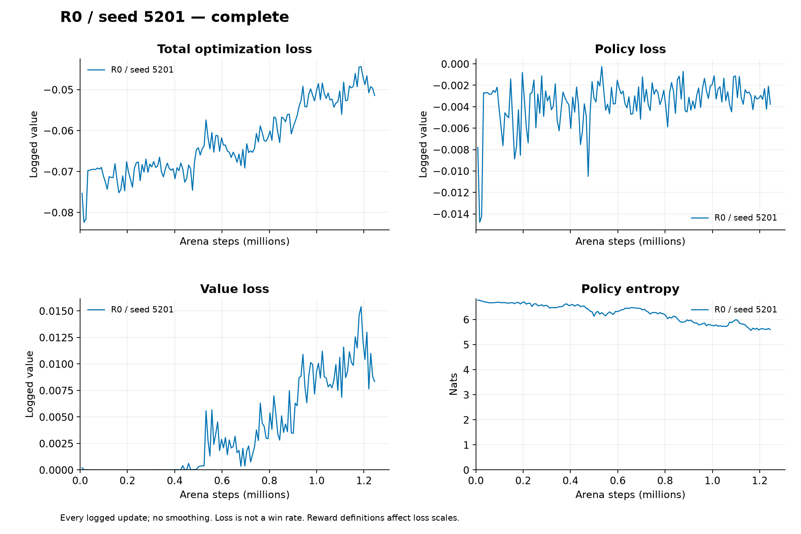

# A-PILOT-R0: learning signals without sufficient dueling performance

Author: Libor Burian. Exploratory seed 5201; fixed-spawn 1v1, R0 damage coefficient 0.25. This completed pilot **fails the registered selection gate**. It is not a confirmation model or a deployment recommendation. Method, game, architecture, hyperparameters and criteria are frozen in the [active protocol](../../docs/duel-protocol.md) and [resolved configuration](../../configs/duel-pilot-R0.json).

## Identity and training

Training source: [`ecd8e3b05a5f42963dc5359e259f4bdf376ff4c8`](https://github.com/BurnyCoder/counter-strike-reinforcement-learning-selfplay/tree/ecd8e3b05a5f42963dc5359e259f4bdf376ff4c8). The endpoint records a later documentation-only revision; the learning source tree stayed unchanged. Initial/final checkpoint SHA256 and initial parameter fingerprints are in [assessment.json](data/pilot-R0/assessment.json); exact raw-file hashes are in [evidence.json](data/pilot-R0/evidence.json).

The run completed its full **1,245,184 arena steps, 152 updates**, in 575.187 seconds measured by the trainer; group launch/supervision took 586.343 seconds. It used 64 parallel arenas, one CPU thread, CUDA learner inference/optimization, CPU frozen opponents and historical self-play. [Result](data/pilot-R0/result.json), [host telemetry](data/pilot-R0/group.json), [full metrics](data/pilot-R0/metrics.jsonl). Training recorded 3,986 rounds, 1,168 learner wins and 2,184 draws; these changing-opponent outcomes are not held-out benchmark scores.

## Primary validation

Win/draw/loss scores are 1/0.5/0. Baselines and spawn ends have equal weight regardless of their match counts. Validation root is 3,000,000; random actions use 128 paired seeds and both ends. Two deterministic policies produce one trajectory per end, so those cells have only two matches. [Initial rounds](data/pilot-R0/initial_validation.json), [final rounds](data/pilot-R0/final_validation.json).

| Opponent | Initial score | Final score | Final wins / draws / losses | Matches per endpoint |
|---|---:|---:|---:|---:|
| Random categorical actions | 0.500000 | 0.537109 | 19 / 237 / 0 | 256 |
| Corresponding initial policy | 0.500000 | 0.500000 | 0 / 2 / 0 | 2 |
| Moving quantized scripted benchmark | 0.000000 | 0.000000 | 0 / 0 / 2 | 2 |
| Equal-opponent aggregate | 0.333333 | 0.345703 | — | 260 |

Improvement is **0.0123698**, below the preregistered **0.10** pilot gate. The paired match-bootstrap 95% interval is [0.0071615, 0.0182292], conditional on this single checkpoint pair. It does not measure variation between independent training seeds. The final elimination fraction is 21/260 = **8.08%**; most games still time out. Reproduce with `uv run python scripts/assess_duel_pilot.py R0`; this uses validation only, checks endpoint identity and copies raw evidence without modifying model weights. No final-test data was opened.

## Diagnosis and secondary evaluation

Against random actions, mean damage rose from 9.180 to 30.664, while hits per shot rose from 0.01421 to 0.07704. Reload occupancy fell from 0.43733 to 0.15602 and aim saturation from 0.94728 to zero. These are pooled counter summaries in [assessment.json](data/pilot-R0/assessment.json), not independent causal tests. The moving benchmark still won both deterministic matches; final mean damage was 25 and mean duration 0.55 seconds. More stable aim and some damage are insufficient to establish useful elimination skill.

Secondary stochastic evaluation uses 128 pairs for every baseline: 768 matches per endpoint. Aggregate score rose from **0.332682 to 0.369141**; final scores were random 0.560547, initial 0.546875, scripted 0.000000. [Initial stochastic rounds](data/pilot-R0/initial_validation_stochastic.json), [final stochastic rounds](data/pilot-R0/final_validation_stochastic.json). This modest difference does not rescue the failed primary gate and cannot be substituted for the registered deterministic deployment criterion.

The final update had finite policy loss −0.003774, value loss 0.008344, entropy 5.601829, approximate KL 0.010806, clipping fraction 0.145671 and gradient norm 0.616782. Loss values alone do not establish competence. Existing focused checks and the 79-test local suite passed; no new learning-pipeline defect was identified in this pilot's records. This does not prove the absence of all defects or explain the failure causally. [Learning audit](../learning-audit/summary.md), [review](../../docs/review-stage-a.md).

## Decision, limits and sources

[SVG](losses/pilots__R0__seed5201.svg), [reward components](losses/training/pilots__R0__seed5201-rewards.png), [combat rates](losses/training/pilots__R0__seed5201-combat.png), [all pilot curves and evaluations](../../docs/experiment-plots.md). Every logged update is shown without smoothing; loss/reward changes do not replace the benchmark gate.

Proceed with the preregistered matched **R1** pilot, doubling only damage shaping to 0.50. The next run must retain seed, actor/critic initialization, arena steps, algorithm and opponent schedule. Stronger damage feedback is a hypothesis, not a diagnosis established by these observations. Advantage normalization means reward magnitude does not translate directly into a proportional policy update; changing the relative damage/outcome weighting may still affect trajectories and credit assignment. [TorchRL PPO loss](https://docs.pytorch.org/rl/stable/reference/generated/torchrl.objectives.ClipPPOLoss.html), [registered objective implementation](https://github.com/BurnyCoder/counter-strike-reinforcement-learning-selfplay/blob/ecd8e3b05a5f42963dc5359e259f4bdf376ff4c8/src/ministrike/learning/objectives.py).

One exploratory seed, a fixed layout, adaptive self-play opponents and limited pilot length prevent claims of generalization, convergence or retraining reliability. Reward design and stochastic/deterministic evaluation require environment-specific measurement; library defaults are not universal guarantees. [Official SB3 guidance](https://stable-baselines3.readthedocs.io/en/master/guide/rl_tips.html), [RL evaluation uncertainty](https://arxiv.org/abs/2108.13264). The [R0 diagnostic amendment](../../docs/amendments/2026-10-23-R0-diagnosis.md) records the prospective R1 decision without rewriting this failed result.
