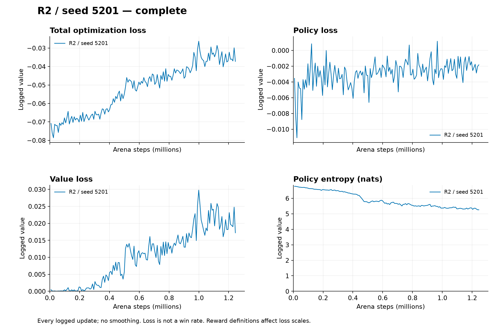

# A-PILOT-R2: aim-potential shaping does not pass selection

Author: Libor Burian. Exploratory seed 5201; [resolved configuration](../../configs/duel-pilot-R2.json), [prospective amendment](../../docs/amendments/2026-10-23-R1-diagnosis.md), [active protocol](../../docs/duel-protocol.md). R2 adds `gamma*Phi(next)-Phi(current)` to R1's outcome plus 0.50 normalized net effective damage. The visible aim potential is capped at 0.1 and zero at termination. This uses the [potential-difference construction of Ng, Harada and Russell](https://people.eecs.berkeley.edu/~russell/papers/icml99-shaping.pdf); it does not imply convergence in this partially observed self-play setting.

## Identity and execution

Training source [`e0a2420e2b57e10b5ccf1448d91d8ecf967a8a1c`](https://github.com/BurnyCoder/3d-firstperson-shooter-reinforcement-learning-selfplay/tree/e0a2420e2b57e10b5ccf1448d91d8ecf967a8a1c) was published before launch. Initial actor and critic tensor hashes match both earlier pilots exactly. [Assessment](data/pilot-R2/assessment.json) records checkpoint and tensor identities; [evidence hashes](data/pilot-R2/evidence.json) bind all raw artifacts.

R2 completed **1,245,184 arena steps, 152 updates**, in **603.484 seconds** of trainer time; group supervision took **616.656 seconds**, exit code 0. Its 6,106 self-play rounds included 3,114 learner wins and 1,433 draws against changing frozen opponents. These counts are not fixed-benchmark skill estimates. Host RAM headroom reached **16.41%**, below the 20% headroom observed when selecting the configuration; no OOM occurred. [Result](data/pilot-R2/result.json), [group/telemetry](data/pilot-R2/group.json), [every update](data/pilot-R2/metrics.jsonl).

## Primary deterministic validation

Same root 3,000,000, paired worlds, equal opponent/end weighting and controls as R0/R1. Random controls use 128 paired seeds and two ends; fully deterministic baselines have one unique trajectory per end. [Initial rounds](data/pilot-R2/initial_validation.json), [final rounds](data/pilot-R2/final_validation.json).

| Opponent | Initial score | Final score | Final wins / draws / losses | Matches |
|---|---:|---:|---:|---:|
| Random actions | 0.500000 | 0.658203 | 81 / 175 / 0 | 256 |
| Corresponding initial policy | 0.500000 | 0.500000 | 0 / 2 / 0 | 2 |
| Moving quantized scripted benchmark | 0.000000 | 0.000000 | 0 / 0 / 2 | 2 |
| Equal-opponent aggregate | 0.333333 | 0.386068 | — | 260 |

Improvement **0.0527344** fails the **0.10** selection gate. The paired match-bootstrap 95% interval is **[0.0442708, 0.0611979]**, conditional on this model pair, not independently retrained models. Final elimination fraction is **83/260 = 31.92%**. Random-opponent side scores are 0.738281 and 0.578125. Initial-policy rounds still time out and the script wins both deterministic trajectories. No final-test data was accessed.

Against random opponents, mean damage rises from 9.180 to **56.738**, hits per shot from 0.01421 to **0.08115**, and duration falls from 20 to **14.988 seconds**. R2 deals zero damage in both final initial-policy and scripted cells. Raw rows and the assessment script define all denominators. The finite final policy loss is −0.001835, value loss 0.017212, entropy 5.259078, approximate KL 0.010285, clipping fraction 0.145101 and gradient norm 0.720991. These show recorded optimizer activity, not proof of correct or useful learning by themselves.

## Secondary stochastic evaluation

[Initial stochastic rounds](data/pilot-R2/initial_validation_stochastic.json) and [final stochastic rounds](data/pilot-R2/final_validation_stochastic.json) each contain 768 matches, 128 paired seeds per opponent/end.

| Opponent | Initial score | Final score | Final wins / draws / losses |
|---|---:|---:|---:|
| Random actions | 0.498047 | 0.804688 | 156 / 100 / 0 |
| Corresponding initial policy | 0.500000 | 0.816406 | 162 / 94 / 0 |
| Moving quantized scripted benchmark | 0.000000 | 0.000000 | 0 / 0 / 256 |
| Equal-opponent aggregate | 0.332682 | 0.540365 | — |

Secondary improvement is **0.207682**, elimination **74.74%**. This checkpoint learns to beat weak stochastic controls more often, but still never beats the moving script. Both the learner and initial-opponent action selection differ between evaluation modes, so their mode gap is not an isolated causal effect of learner sampling for that opponent. Primary selection remains failed. A single matched seed does not establish R1's observed advantage over R2 as a reliable effect across retraining.

## Saved figures and interpretation

[SVG](losses/pilots__R2__seed5201.svg), [three-pilot loss comparison](losses/reward-pilots.png), [primary scores](losses/validation-deterministic.png), [secondary scores](losses/validation-stochastic.png), [data provenance and reproduction](../../docs/experiment-plots.md). These curves retain raw update averages; no smoothing or inferred missing losses.

All three pilots now fail the unchanged primary gate. **Do not start confirmation.** Preserve negative findings and register a specific intervention before more gameplay experiments. A useful candidate diagnosis is the deterministic/stochastic action-selection gap with opponent mode held fixed; action loops, visibility and update correctness remain hypotheses to test, not established causes. The [post-pilot amendment](../../docs/amendments/2026-10-23-R2-diagnosis.md) records this boundary. Reproduce the numerical assessment with `uv run python scripts/assess_duel_pilot.py R2`.
