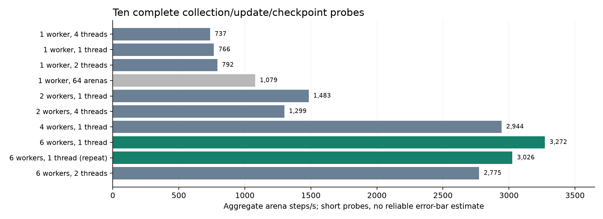

# Concurrent learning in MiniStrike

Libor Burian | Technical execution note | 22 October 2026

## Abstract

MiniStrike trains six independent MAPPO policies for a controlled self-play comparison. A single learner spent 82.87% of measured update time collecting trajectories on CPU. Eight initial hardware probes selected six concurrent CUDA learners at 3,272.46 aggregate arena steps/s versus 736.85 for one self-play learner. Two follow-up probes retained one CPU thread per learner. A 49.45-second live observation measured 3,437.31 aggregate steps/s and mean sampled GPU utilization of 15.49%. These observations support a scheduling change, not stronger policies, sustained performance or full accelerator utilization. Frozen learning budgets and the deadline were retained. [Published evidence](https://github.com/BurnyCoder/counter-strike-reinforcement-learning-selfplay/tree/main/reports/performance) includes every probe.

## Context, motivation and related work

NumPy computes authoritative game transitions and visibility for ten-player arenas; CPU inference supplies actions, and PyTorch updates networks on an RTX 5070 Laptop GPU. This intervention sought faster completion of six registered models with unchanged learning batches. It reuses Python's process executor [1] and TorchRL's MAPPO components [4]. TorchRL's collection documentation [2] and PyTorch's tuning guide [3] describe the synchronization and threading tradeoffs motivating these measurements.

## Method

Each fresh calibration worker used one warmup update followed by four measured updates, including production collection, GAE/PPO optimization, CPU actor synchronization and final checkpoint writing. Each ordinary update collected 16 arenas times 128 ticks, then ran three PPO epochs with minibatches of 256 arena-time rows. The actor has two 128-unit hidden layers; the centralized critic has two 256-unit layers. Standard starts and eight immutable snapshot identities with identical initial weights approximated snapshot-grouping overhead, not the behavior of trained opponents. The 64-arena diagnostic changed learning batch size and was not adopted.

An arena step advances an entire arena once. Aggregate rate is the sum of measured arena steps divided by the interval from the earliest worker's measurement start to the latest worker's measurement end. Startup and warmup are excluded from these rates and retained separately in the raw receipts. Concurrent groups alternated self-play and fixed opponents, with calibration seeds starting at 8002. No primary final-test results informed scheduling. The primary suite uses training seeds 111, 222 and 333 in each condition.

## Results

The first six-worker probe processed 49,152 measured steps in 15.019915 seconds: 11.15% faster than four workers and 4.44 times the single self-play reference. A later comparison measured 3,026.17 steps/s with one CPU thread versus 2,774.65 with two, an 8.31% slowdown. The overlapping 25-sample host observation averaged 93.33% CPU utilization and at least 2.285 GiB available RAM. It includes transitions and unrelated work. All ten probes completed and were retained. A separate profile measured 2.307 seconds for CPU collection; its overlapping cumulative function times cannot be added.

The live observation ran from 20:35:11.856 to 20:36:01.315 UTC. All six learners advanced, collectively adding 169,984 steps. Forty-five device-wide samples ranged from 2% to 61% GPU utilization, averaging 15.49%; peak sampled device memory use was 4,774 MiB of 8,151 MiB. Desktop applications can contribute to these device-wide readings. Throughput uses asynchronous log snapshots, so endpoints have approximately one-update granularity. Initial curriculum states differed from the standard-start calibration. This observation verifies functioning concurrent training; it is not a controlled replication of the probe speedup.

## Execution amendment and recovery

The suite executes six models concurrently, with 96 arenas in total. Each retains its 4,167,680-step target, 16-arena batch, optimizer, reward, curriculum and analysis settings. Runtime caps were reallocated within the original training window ending 23 October at 05:35:52.872233 UTC; the overall deadline remains 07:32:38.503505 UTC. Calibration pauses and recovery do not extend it. The thread comparison stopped learners at exact periodic checkpoints to release RAM, then resumed one thread per worker.

The first handoff preserved update 700 and 1,433,600 steps. Recursive comparison verified identical model, optimizer, simulator, opponent and RNG states. Only runtime fields and elapsed accounting changed. Two attempts were interrupted at approximately 20:29:49 and 20:36:29 UTC; the second recorded BrokenProcessPool. The user reported a Codex restart, consistent with external termination but not independent proof of its cause. Recovery archived attempts, restored durable checkpoints, charged interrupted compute and removed archived uncheckpointed suffixes from canonical metrics. A subsequent hidden Windows WMI launch ran outside Codex's process tree and advanced all six models.

## Discussion, limitations and conclusion

Six workers with one CPU thread each were the fastest tested configuration. Larger worker counts were not tested. Most settings have one short probe; six workers with one thread have two. This cannot establish reliable confidence intervals, statistical significance or thermal steady-state performance; no error bars are drawn. Mixed-condition concurrency versus a self-play-only reference is not a pure causal estimate of worker count. The two-, four- and six-worker groups retain a balanced condition mix.

Parallel execution still spends substantial time on CPU simulation and inference. Low average GPU utilization is therefore compatible with faster end-to-end training. Changing thread counts may affect floating-point execution; bitwise equivalence of future trajectories is not claimed. Learning quality remains unmeasured by these probes and must be assessed through the separately registered independent-seed comparison. Negative or incomplete primary results must be retained.

## Appendix: evidence and sources

The accompanying summary links all reports, raw timings, configurations, CPU profile, live telemetry and recovery audits. docs/protocol.md records the primary protocol. Benchmark code was public before execution; configurations identify its commits.

- [1. Python ProcessPoolExecutor](https://docs.python.org/3.12/library/concurrent.futures.html#processpoolexecutor)
- [2. TorchRL collection and synchronization](https://docs.pytorch.org/rl/stable/reference/collectors_single.html)
- [3. PyTorch performance tuning guide](https://docs.pytorch.org/tutorials/recipes/recipes/tuning_guide.html)
- [4. TorchRL multi-agent PPO tutorial](https://docs.pytorch.org/rl/stable/tutorials/multiagent_ppo.html)
