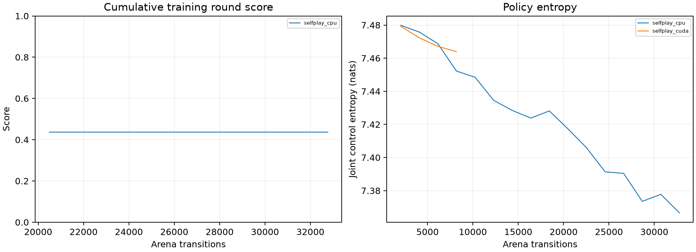

# MiniStrike experiment summary

The pre-specified comparison is pending: 0/3 matched training-seed pairs have complete, equal-budget results. Available pairs are retained in comparison.json; no subset is presented as the final hypothesis test.

## All recorded experiments

| Run | Frames | Elapsed seconds | Initial score [95% CI] | Final score [95% CI] |
| --- | --- | --- | --- | --- |
| selfplay_cpu | 32768 | 95.9 | 0.167 [0.167, 0.167] (complete) | 0.167 [0.167, 0.167] (complete) |
| selfplay_cuda | 8192 | 12.4 | 0.167 [0.167, 0.167] (complete) | 0.167 [0.167, 0.167] (complete) |

## Networks and metrics

| Policy | Architecture | Training/objective | Data/curriculum | Domain | Accuracy/fill/completion |
| --- | --- | --- | --- | --- | --- |
| Learned actor | Shared 2x128 tanh MLP; 384 local-history inputs; 6 categorical heads | MAPPO clipped policy loss and entropy | Online simulated rounds; combat/objective/standard starts | One MiniStrike map | N/A |
| Team critic | 2x256 tanh MLP; 1920 combined inputs; 5 values | Team return regression and GAE | Same online rounds | Training only | N/A |
| Random/rush/guard controls | No trained network | Fixed rules; no optimizer | No training data | Same map and observations | N/A |

Classification accuracy and fill/completion metrics are N/A because this task has no labeled classification or text-completion targets. Round scores, objective events, and damage are reported instead.

## Terms and interpretation

MAPPO is multi-agent proximal policy optimization: local actors learn with a team critic. Self-play trains against frozen versions of the learner; fixed-opponent training holds the opposition rule constant. Score assigns win/draw/loss values 1/0.5/0. A 95% confidence interval describes an estimation procedure under stated assumptions, not a 95% probability that a fixed unknown value lies inside this particular interval. Match intervals condition on one model; the paired-seed interval concerns variation across independent training runs. N/A means a metric is not applicable; pending means evidence has not been recorded.

Training opponents/curriculum change; cumulative training scores are not held-out learning curves. Individual reports contain side/baseline breakdowns and raw evidence. [Paper](paper.md) documents methods and limitations; [comparison data](comparison.json) retains exclusions.
